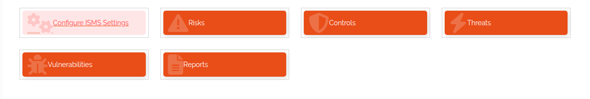

.. _isms-anchor:

#########################
How the ISMS is organised
#########################

|licensed| — on self-hosted installations this needs a license that includes ISMS; in the cloud it is
part of the subscription. See :doc:`../start/editions`.

.. contents::
   :local:

An **Information Security Management System (ISMS)** is the set of policies, processes and controls an
organisation uses to identify, evaluate and treat information security risks — aligned with standards
such as **ISO/IEC 27001**. Its goal is to keep the **confidentiality, integrity and availability** of
information (the *CIA triad*). Typical elements of an ISMS are risk management, policies and procedures,
roles and responsibilities, asset management, incident management and continual improvement.

The DataGerry ISMS covers the risk management part: it models risks, evaluates them against the assets
in your CMDB, and documents how they are treated. This page explains the building blocks and how they fit
together. The task pages build on it:

* :doc:`../guides/isms-configure` — set up the evaluation scales and the risk matrix
* :doc:`../guides/isms-catalogues` — maintain threats, vulnerabilities, risks and controls
* :doc:`../guides/isms-risk-assessments` — assess risks and assign controls
* :doc:`../guides/isms-reports` — risk matrix, risk treatment plan, SoA and risk assessments report
* :doc:`../reference/isms-csv-import` — bulk-load the catalogues from CSV

You open the ISMS from **Toolbox → ISMS**. The overview shows a card for each area you have the rights
for: **Configure ISMS Settings**, **Risks**, **Controls**, **Threats**, **Vulnerabilities** and
**Reports**.

   The ISMS overview.

Three layers
============

The ISMS has three layers. Each one builds on the one before.

**Configuration** — the scales every evaluation uses. You set it up once, before the first assessment:

* **Risk classes** — the labelled risk levels a result falls into, e.g. *Low*, *Medium*, *High*, each
  with a colour.
* **Likelihoods** — how probable it is that a risk occurs. Each level has a numeric
  *calculation basis*.
* **Impacts** — how severe the consequences are. Each level has a numeric *calculation basis*.
* **Impact categories** — the areas in which you judge impact, e.g. *Financial*, *Legal*,
  *Operational*. A category describes what each impact level means in that area.
* **Protection goals** — the security objectives a risk can affect. *Confidentiality*, *Integrity* and
  *Availability* are predefined; you can add your own.
* **Risk matrix** — assigns a risk class to every combination of likelihood and impact.

**Catalogues** — the reusable, asset-independent descriptions of what can go wrong and what you do about
it:

* **Threats** — potential causes of an unwanted incident (*Phishing attack*, *Fire*).
* **Vulnerabilities** — weaknesses a threat can exploit (*Outdated software*).
* **Risks** — a scenario built from threats and/or vulnerabilities, or an event, and the protection
  goals it endangers.
* **Controls** — safeguards, requirements and measures that reduce risks, e.g. from the ISO/IEC
  27001:2022 catalogue.

**Assessment** — where the catalogues meet your CMDB:

* **Risk assessments** — evaluate one risk for one object or object group, before and after treatment,
  and document the treatment and its audit.
* **Control assignments** — link a control to a risk assessment, with its own implementation status,
  dates, priority and responsible person.

The reports read from the assessment layer.

How the building blocks connect
===============================

.. list-table::
   :header-rows: 1
   :widths: 22 38 40

   * - Building block
     - Refers to
     - Used by
   * - Risk class
     - —
     - Risk matrix cells; the calculated risk of a risk assessment
   * - Likelihood
     - —
     - Risk matrix rows; risk assessments (before and after treatment)
   * - Impact
     - —
     - Risk matrix columns; impact categories; risk assessments
   * - Impact category
     - Impacts (one description per impact level)
     - Risk assessments (one impact selection per category)
   * - Protection goal
     - —
     - Risks
   * - Risk matrix
     - Likelihoods × impacts → risk class
     - Risk assessments, risk matrix report
   * - Threat
     - A source (optional)
     - Risks of type *Threat x Vulnerability* and *Threat*
   * - Vulnerability
     - A source (optional)
     - Risks of type *Threat x Vulnerability*
   * - Risk
     - Threats, vulnerabilities, protection goals, a category
     - Risk assessments
   * - Control
     - A source and an implementation state (optional)
     - Control assignments
   * - Risk assessment
     - One risk; one :ref:`object <objects-anchor>` **or** one
       :ref:`object group <object-groups-anchor>`; :ref:`persons <persons-anchor>` and
       :ref:`person groups <person-groups-anchor>` as assessor, owner, interviewees, responsible
       person and auditor
     - Control assignments; all ISMS reports
   * - Control assignment
     - One control; one risk assessment; a person or person group responsible for implementation
     - Risk treatment plan, risk assessments

The ISMS does not keep its own asset list. The *asset* of an assessment is always a normal DataGerry
object or object group, and the people involved are DataGerry persons and person groups. That is why
risk assessments are opened from the object, object group or risk they belong to, not from the ISMS
menu.

How a risk is scored
====================

Each likelihood and impact level carries a numeric **calculation basis**. In a risk assessment you pick
one impact level per impact category and one likelihood. The **calculated risk** is

``maximum impact (calculation basis) × likelihood (calculation basis)``

where the maximum impact is the highest impact selected across all impact categories. The risk matrix
then gives the cell for that likelihood and maximum impact a **risk class**, which supplies the label
and the colour shown in forms and reports.

An assessment is scored twice: **before treatment** (the initial risk) and **after treatment** (the
residual risk once the chosen treatment and controls are in place).

Risk types
==========

The **risk type** decides which parts of a risk you fill in:

.. list-table::
   :header-rows: 1
   :widths: 25 75

   * - Risk type
     - Meaning
   * - *Threat x Vulnerability*
     - A known threat exploiting a known vulnerability. Needs threats and vulnerabilities.
   * - *Threat*
     - A direct threat without a specific vulnerability. Needs threats.
   * - *Event*
     - A scenario or occurrence that may cause an impact, without a threat or vulnerability. Needs
       consequences and a description.

Treatment options
=================

A risk assessment records one of four treatment strategies:

* **Avoid** — remove the risk entirely by stopping the activity or removing the risk source, e.g.
  decommissioning a vulnerable system.
* **Accept** — acknowledge the risk and its consequences, typically when the risk is low or mitigation
  is not cost-effective.
* **Reduce** — apply controls or take actions that lower the likelihood or the impact, e.g. firewalls or
  backup systems.
* **Transfer/Share** — shift the risk to another party (insurance, outsourcing) or share it with
  partners.

Access
======

Every ISMS area has its own rights (``base.isms.risk.view``, ``base.isms.riskAssessment.add``,
``base.isms.report.view`` …). From 3.3 the ISMS routes, menus and actions are consistently gated by these
rights, and the ISMS import needs ``base.isms.import.add`` *(3.3)*. See :doc:`../reference/rights`.
