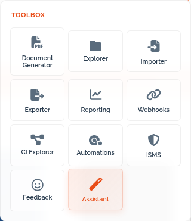
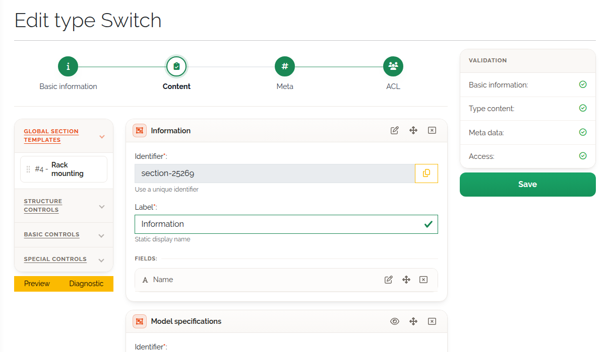

.. _assistant-anchor:
.. _datagerry-assistant-anchor:

###################
The Start Assistant
###################

.. contents::
   :local:

The Start Assistant (also called the DataGerry Assistant) builds a starter data model on a
new, empty installation: you pick your industry and the data categories you need, and it
creates the matching :doc:`types <model-types>` and categories. Afterwards you adapt them
like any type you created yourself.

.. note::
   Looking for the **AI Assistant**? It drafts content for PDF templates and is part of
   the Document Generator — see :ref:`docgen-ai-assistant`.

When the assistant is available
===============================

The assistant opens automatically after login when all of these are true:

* you hold ``base.framework.type.add`` and ``base.framework.category.add``,
* the database contains no categories, types or objects,
* the assistant hasn't run on this installation before.

It runs **once per installation**. A run is all or nothing: if it fails part-way, the
created types and categories are removed again and the assistant can be run once more.

While your data model is still empty you can reopen it from **Toolbox → Assistant** in
the top-right menu. Once data exists, that entry shows **You're already set up** instead.

   The Assistant entry in the Toolbox.

To build your model from scratch instead, click **Cancel** on the welcome dialog.

Run the assistant
=================

1. On **Welcome to DATAGERRY**, click **Start Assistant**.
2. **Choose your industry** — select one or more of **Telecommunications**,
   **Helpdesk**, **Service provider** and **Healthcare**, then click **Continue**.

   .. figure:: ../img/dg_assistant/assistant_branches.png
      :width: 700

      Choosing the industry.

3. **Select data categories** — the categories recommended for your industries are
   pre-selected. Each category adds a set of configuration item types. Switch individual
   categories on or off.

   .. figure:: ../img/dg_assistant/assistant_profiles.png
      :width: 700

      Selecting data categories.

4. Click **Create**. DataGerry creates the types of all selected categories and opens the
   type list (**Framework → Types**). In the sidebar the new types appear under
   categories.

Data categories
---------------

.. list-table::
   :header-rows: 1
   :widths: 28 72

   * - Category
     - Recommended for
   * - **User management**
     - All industries
   * - **Location**
     - All industries
   * - **Rack View** *(3.3)*
     - All industries
   * - **Client management**
     - Helpdesk, Healthcare
   * - **IPAM**
     - Telecommunications, Helpdesk
   * - **Server management**
     - Telecommunications, Helpdesk
   * - **Network infrastructure**
     - Telecommunications, Helpdesk

**Rack View** and **IPAM** carry a **New feature** tag *(3.3)*. They are offered only when
the IPAM license feature is available — see :doc:`ipam` and :doc:`racks`.

After the assistant
===================

In the type list, open any generated type with the edit icon in the **Actions** column to
see how it is built, and change it to fit your needs. Add your own types with **Add**.

.. figure:: ../img/dg_assistant/assistant_types_table.png
   :width: 1000

   The type list after the assistant has run.

   Editing a generated type.
