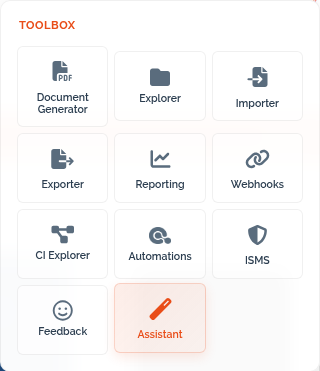

.. _assistant-anchor:
.. _datagerry-assistant-anchor:

###################
The Start Assistant
###################

|since-331|

.. contents::
   :local:

The Start Assistant (the setup assistant) prepares a new, empty workspace: it shows your
plan, then sets up your data model — empty, from one or more ready-made **best practice
models**, or from a data model file exported from another DataGerry instance. Afterwards it
starts a short product tour. You adapt the created :doc:`types <model-types>` and
categories like any you created yourself.

.. admonition:: Cloud and self-hosted
   :class: edition

   In the cloud *(3.3.1)* you get the assistant described on this page. Self-hosted 3.3
   installations still have the previous Start Assistant: on **Welcome to DATAGERRY** you
   click **Start Assistant**, choose one or more industries (**Telecommunications**,
   **Helpdesk**, **Service provider**, **Healthcare**), switch the pre-selected data
   categories (**User management**, **Location**, **Rack View**, **Client management**,
   **IPAM**, **Server management**, **Network infrastructure**) on or off and click
   **Create**. **Rack View** and **IPAM** are offered only with a license that includes
   IPAM. It runs once per installation. Self-hosted installations get the new assistant
   with 3.4; there it also asks for your edition and activates your license.

.. note::
   Looking for the **AI Assistant**? It drafts content for PDF templates and is part of
   the Document Generator — see :ref:`docgen-ai-assistant`.

When the assistant opens
========================

The assistant opens by itself after sign-in when all of these are true:

* you hold ``base.framework.type.add`` and ``base.framework.category.add``,
* the workspace is empty — no types, categories, objects, relations or other data a
  :ref:`workspace reset <assistant-reset-anchor>` would remove,
* no data model has been set up with the assistant yet.

Click **Set up later** on the first page, or the close button on a later one, to leave it.
Nothing is saved until you click **Set up now**, so the assistant opens again at your next
sign-in. Choosing **Empty data model** also counts as a decision: afterwards the
assistant no longer opens by itself.

To reopen it, open **Toolbox → Assistant** in the top-right menu (shown to users with the
two rights above).

   The Assistant entry in the Toolbox.

If the workspace already holds data, the entry shows **Your workspace already has a data
model** with the buttons **Keep my data** and **Reset workspace** — see
:ref:`assistant-reset-anchor`. Users without the right to reset see **You're already set
up** instead.

The steps
=========

The left side lists the steps with your choices so far; **Back** returns to the previous
step. In the cloud the assistant has four steps:

1. **Welcome**
2. **Your plan**
3. **Data model**
4. **Review**

Welcome
-------

**Welcome to your DATAGERRY Cloud** (during a trial: **Welcome to your DATAGERRY
trial**, marked **All Pro features in trial**) shows what was detected: **Deployment**,
**Database** (**MongoDB connected**), **Version** and, during a trial, the **Plan** with
the days left. Tenant and plan come from the Service Portal; no license activation is
needed in the cloud. Click **Get started**.

Your plan
---------

The plan card shows your plan — for example *Subscription: Medium* or *Trial · Medium* —
with its end or renewal date and its status (**Active**, **Trial** or **Inactive**).
Below, **Pro Features** lists what the plan includes:

.. list-table::
   :header-rows: 1
   :widths: 30 70

   * - Pro feature
     - Covers
   * - **REST API**
     - Interface for integrations and scripts
   * - **Networks**
     - IPAM, ports, cabling view and rack view
   * - **Document Generator**
     - Reports and documents from object data
   * - **Automations**
     - Rules and webhooks for recurring tasks
   * - **ISMS**
     - Information security management per ISO 27001

A feature your plan does not include is shown with a lock and the plan it is available
from. During a trial, a note explains that types created from the best practice models are
kept after the trial, and **Choose a plan in the Service Portal** opens the portal. If the
plan cannot be loaded, the assistant says so and you can continue anyway. See
:doc:`../cloud/subscriptions`.

Data model
----------

**How would you like to set up your data model?** offers three choices:

**Empty data model**
   Start without types and categories and build your own — see :doc:`../start/first-cmdb`.

**Best practice models**
   Combine one or more ready-made models with categories, types and relations — see
   :ref:`assistant-models-anchor`.

**Import data model**
   Upload a data model file (``.json``) exported from another DataGerry instance — see
   :ref:`assistant-import-anchor`.

The two last choices are shown only to users holding ``base.*`` (by default the
Administrator group), because they replace the whole configuration. Other users can only
start with an empty data model.

.. note::
   Once a data model is set up, you can't come back to this step to change it. To use
   different models later, open the assistant again and reset the workspace.

Review
------

**Ready to set up** lists your choices: **Environment**, **Edition / plan**, **Pro
features**, **Data model** and the number of **New types**. **Change** next to a row
returns to the step that sets it. Click **Set up now**: a progress line shows the data
model being created. If it fails, the error is shown and nothing is created; you can
change your choice and try again.

.. _assistant-models-anchor:

Best practice models
====================

Under **Choose models** the models are shown as cards. Each card shows a short label
(for example *Clients & users*), the title, a summary and the number of categories,
types, fields and relations. Use **Search models** to filter by title, label, summary or
category. Tick as many cards as you need.

**View details** opens a model: its description, who it is **Suited for**, which profiles
of the previous assistant it was built from, every category with its types (expand a type
to see its sections and fields, and which types a reference field points to) and its
relations. **Select this model** adds it to your selection.

Models are combined by name: a type, category, section template or relation that several
selected models contain — such as *Company*, *Person* or *Room* — is created only once.

The best practice models are maintained by becon and can be extended between releases; the table
shows the models available with 3.3.2.

.. list-table:: Available models
   :header-rows: 1
   :widths: 24 50 26

   * - Model
     - What it adds
     - Requires
   * - **Workplace Management**
     - End devices, who uses them and where they are: clients, monitors, printers, mobile
       devices, operating systems and software products.
     - —
   * - **Data Center & Servers**
     - Physical and virtual servers, storage and power in your server rooms: racks,
       servers, storage systems, appliances, UPS, virtualization clusters, virtual
       servers, applications, cables, and Supernet, Subnet and VLAN.
     - IPAM
   * - **Network Infrastructure**
     - Switches, routers, firewalls, access points, patch panels and internet lines, with
       racks, cables, and Supernet, Subnet and VLAN.
     - IPAM
   * - **AI Systems & Models**
     - An inventory of AI use cases, systems, models, agents, deployments, datasets,
       evaluations and compute clusters.
     - —
   * - **Medical Technology**
     - Medical devices with their safety and metrological inspections, incidents,
       instructions and maintenance contracts.
     - —
   * - **Vehicle Fleet**
     - Vehicles, drivers, telematics units, fuel cards, charging points, depots, leasing
       contracts and insurance policies.
     - —
   * - **Software & Licenses**
     - Software products, licenses, license assignments, software contracts and the
       devices software is used on.
     - —
   * - **Facility Management**
     - Sites, buildings, floors, rooms and the technical equipment that needs regular
       inspection (HVAC, elevators, fire protection, emergency lighting, electrical
       installations), with service contracts.
     - —
   * - **Production & OT**
     - Plants, production lines, machines, controllers, HMI panels, industrial switches,
       sensors, security zones and remote access.
     - —
   * - **SBOM & Software Supply Chain**
     - Products, releases, SBOM documents, components, open-source licenses,
       vulnerabilities, VEX statements, security advisories and authority reports.
     - —
   * - **Business Services & Continuity**
     - Business and IT services, applications and infrastructure components, business
       impact analyses, service level agreements and continuity plans.
     - —
   * - **Cloud Resources**
     - Cloud accounts, virtual machines, Kubernetes clusters and namespaces, workloads,
       managed databases, storage buckets and virtual networks.
     - —
   * - **Data Protection (GDPR)**
     - Processing activities, IT systems, data subject and personal data categories,
       processing agreements, technical and organizational measures, impact assessments
       and data breaches.
     - —
   * - **Supplier Management**
     - Suppliers, supplied services, supplier contracts, supplier assessments and
       certificates.
     - —
   * - **Energy Assets**
     - PV plants, inverters, wind turbines, battery storage, CHP units and energy meters
       with their grid connection points.
     - —
   * - **Laboratory & Calibration**
     - Lab instruments, reference standards, calibrations, qualifications, maintenance
       records and operator trainings.
     - —
   * - **School IT**
     - Schools, classes, student and teacher devices, device sets and loans, presentation
       and network devices, and funding programs.
     - —
   * - **Physical Security**
     - Doors, access readers, access profiles and reviews, badges, cameras, video recorders
       and alarm zones.
     - —
   * - **Tools & Equipment**
     - Toolboxes, power tools, ladders, measuring devices and protective equipment, with
       inspections and handovers.
     - —

Every model also brings the shared types *Company*, *Department*, *Team* and *Person*;
about half of them add the location types *Country*, *City*, *Building* and *Room* (Facility
Management adds *Floor*). No model requires another model.

**Data Center & Servers** and **Network Infrastructure** contain the special types Rack,
Cable, Supernet, Subnet and VLAN and types with ports, so they need the IPAM feature.

.. admonition:: Cloud and self-hosted
   :class: edition

   In the cloud every model can be selected; your plan decides which Pro features — such
   as the Rack View, cabling and IPAM of the **Networks** feature — you can use with the
   created types. On a self-hosted installation (3.4) a model that needs IPAM is locked
   without a license that includes IPAM: its card says *Needs IPAM, which your license
   does not include.* See :doc:`ipam`, :doc:`racks` and :doc:`ports-and-cabling`.

Which models do I need?
-----------------------

**Not sure which to choose?** above the cards opens **Which models do I need?** Under
**You want**, pick a use case; **Recommended models** then lists the matching models, the
categories they create and how many types they share (created once):

.. list-table::
   :header-rows: 1
   :widths: 35 65

   * - You want
     - Recommended models
   * - **IT CMDB with software assets**
     - Workplace Management, Data Center & Servers, Network Infrastructure, Software &
       Licenses
   * - **AI governance**
     - AI Systems & Models, Data Protection (GDPR), Supplier Management
   * - **Software manufacturer (CRA)**
     - SBOM & Software Supply Chain, Supplier Management
   * - **Manufacturing**
     - Production & OT, Facility Management
   * - **Hospital**
     - Medical Technology, Network Infrastructure

The button **Select 3 models** (with the matching number) replaces your current selection with the recommended
models. A model you cannot apply is marked **Subscription** and left out. The
recommendation is a starting point — adjust the selection afterwards.

.. _assistant-import-anchor:

Import a data model file
========================

Choose **Import data model** and drop a data model file into **Data model file**. You
create such a file in another DataGerry instance with **Toolbox → Exporter → Export Data
Model** *(3.3.1)*: it holds the types with their sections and fields, the categories, the
section templates and the relation definitions — no objects. The access settings of the
types are not imported.

The assistant checks the file and shows its name, the DataGerry version it came from and
the number of **Categories**, **Types**, **Section templates** and **Relations**. When
the file is fine it says **Ready to import**; otherwise it lists the problems, and you
remove the file with **Remove** and choose another.

After the setup
===============

When the setup has finished, **Your workspace is ready** confirms what was created, and
the sidebar shows the new categories and types. Click **Start tour** for a short product
tour: finding your way in the sidebar and the search, the main menu, creating a type and
adding your first object. You can start the tour again later from **Settings → Product
Tour**.

The data model belongs to you: open a type in **Framework → Types** with the edit icon
in the **Actions** column and change it to fit your needs.

.. _assistant-reset-anchor:

Reset the workspace
===================

To start over with a different data model, reset the workspace. Only users holding
``base.*`` (by default the Administrator group) can do this.

1. Open **Toolbox → Assistant**. The assistant shows **Your workspace already has a data
   model**.
2. Click **Reset workspace**.
3. Under **Verification**, type ``RESET`` into the first field and answer the sum in
   the second (for example *What is 4 + 7?*; the arrows icon asks a new question).
4. Click **Reset workspace**. The assistant then opens again on the empty workspace.

.. warning::
   The reset cannot be undone. It deletes all types, categories, objects, relations and
   the data that depends on them: object links and logs, object groups, locations,
   ports, connections and rack mounts, files attached to objects, reports and your own
   report categories, CI Explorer profiles, document templates, webhooks, ISMS risk
   assessments and control measure assignments, your own section templates and every
   user's settings.

   It keeps users, groups and persons, the root location, the predefined section
   templates and report category, the ISMS catalogues and the files in the file explorer
   that are not attached to an object.

Make a backup or export what you need first — see :doc:`export-data`.
