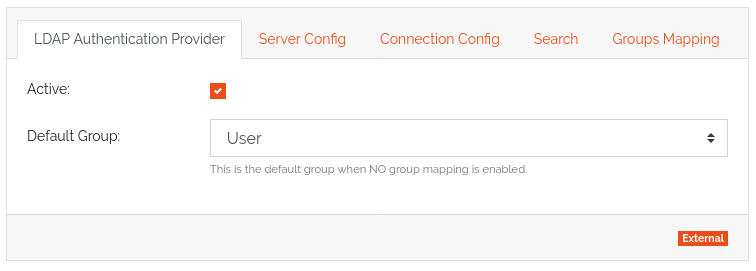
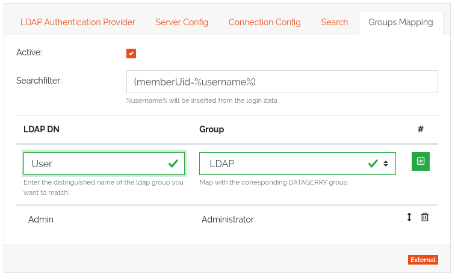

.. _authentication-anchor:

##############
Authentication
##############

.. contents::
   :local:

This page explains how DataGerry checks a login, which access tokens it issues, and
how to connect an LDAP directory. User accounts and groups are covered in
:doc:`users-and-groups`.

.. admonition:: Cloud and self-hosted
   :class: edition

   In the cloud, users sign in with their email address and the Service Portal checks
   the password. A user with access to several subscriptions picks one at login.
   Authentication providers and LDAP are not available, and **Settings →
   Authentication** is not shown. See :doc:`../cloud/users`.
   On a self-hosted installation, users sign in with their user name, and the
   providers described below check the password.

How a login works
=================

On a self-hosted installation, a login runs like this:

#. DataGerry looks up the user by user name. Leading and trailing spaces are
   ignored; if no user has the name exactly as typed, it is tried in lower case.
#. If the user exists, the provider stored with the user (its **Authenticator**)
   checks the password.
#. If that fails, or no such user exists, every active provider is tried in turn.
   An external provider such as LDAP that accepts the credentials creates the user in
   DataGerry, in a predefined group.
#. If no provider accepts the credentials, the login is refused.

Deactivated users cannot log in, even with correct credentials.

Access tokens
=============

A successful login returns an access token, a JSON Web Token (RFC 7519) signed with
RS512. It carries the issuer, the issue and expiry time, and a ``DATAGERRY`` claim
that identifies the user. The web interface sends it as ``Authorization: Bearer
<token>`` with every request.

* **Token lifetime** — set under **Settings → Authentication**, in minutes. The
  default is 1440 (one day).
* You get a token from ``POST /rest/auth/login`` with ``user_name`` and
  ``password``.

.. warning::

   |selfhosted| The RSA key that signs the tokens is stored in the database, in the
   ``settings.conf`` collection. Protect database backups accordingly.

Using the REST API
------------------

.. admonition:: Cloud and self-hosted
   :class: edition

   In the cloud, the REST API uses HTTP Basic authentication with your email and
   password plus an ``x-api-key`` header carrying an API key created in the Service
   Portal. On a self-hosted installation, you use HTTP Basic with user name and
   password, or a Bearer token; access with HTTP Basic requires a license that
   includes the REST API feature.

Details and examples are in :doc:`../reference/rest-api`.

Authentication providers
========================

|selfhosted|

A provider checks a user name and password. DataGerry has two:

.. list-table::
   :header-rows: 1
   :widths: 35 15 50

   * - Provider
     - Kind
     - How it checks
   * - ``LocalAuthenticationProvider``
     - Internal
     - Looks up the user in the DataGerry database and compares the password with
       the stored HMAC-SHA256 hash. Always active; it cannot be switched off, so you
       can always log in locally.
   * - ``LdapAuthenticationProvider``
     - External
     - Searches the user in an LDAP directory (for example Active Directory) and binds
       with the submitted password. DataGerry never stores the password.

Providers are tried in the order they are installed; the local provider is always
first.

**Settings → Authentication** shows the installed providers and how many are
active. The page has these global settings:

.. list-table::
   :header-rows: 1
   :widths: 25 75

   * - Setting
     - Meaning
   * - **Enable external**
     - Must be on for any external provider (LDAP) to be used.
   * - **Token lifetime**
     - How long an access token stays valid, in minutes.

Configure LDAP
--------------

|selfhosted|

#. Open **Settings → Authentication** and turn on **Enable external**.
#. In the LDAP provider card, turn on **Active** and fill in the connection
   settings below.
#. Optionally set up a group mapping (next section).
#. Click **Save**.

.. list-table::
   :header-rows: 1
   :widths: 25 75

   * - Setting
     - Meaning
   * - **Default Group**
     - The DataGerry group for new LDAP users when no group mapping applies.
   * - **Host**, **Port**
     - Address of the directory server.
   * - **Use SSL**
     - Connect with SSL.
   * - **User**, **Password**
     - The service account DataGerry binds with to search for users.
   * - **Version**
     - LDAP protocol version (1–3).
   * - **Basedn**
     - The base DN to search under.
   * - **Searchfilter**
     - Filter that finds the user. ``%username%`` is replaced with the login name.

Users who log in through LDAP for the first time are created in DataGerry with the
authenticator ``LdapAuthenticationProvider``. Their passwords can't be changed in
DataGerry.

LDAP group mapping
------------------

|selfhosted|

The group mapping assigns LDAP users to DataGerry groups based on their LDAP groups.
A DataGerry user belongs to exactly one group, so several LDAP groups must be reduced
to one.

The mapping is off by default. While it is off, new LDAP users go to the
**Default Group**.

   LDAP provider settings with the default group.

To set up the mapping, open the **Groups Mapping** tab of the LDAP provider:

#. Turn on **Active**.
#. Enter a **Searchfilter** that finds the groups of the user at login, for example
   ``(memberUid=%username%)``.
#. Add mapping rows: each row assigns an **LDAP DN** (the full DN of an LDAP group)
   to a DataGerry **Group**. An LDAP group can be mapped to exactly one DataGerry
   group; several LDAP groups can map to the same DataGerry group.

   Mapping LDAP groups to DataGerry groups.

How the mapping is applied:

* The order of the rows matters. If a user is in several mapped LDAP groups, the
  first matching row wins.
* A user found in no mapped group goes to the **Default Group**.
* While the mapping is active, it is applied at **every** login, so existing users
  move when their LDAP groups change.
* If you turn the mapping off later, existing users keep their current group; only
  new users go to the **Default Group**.
* A group used as default group or in a mapping row cannot be deleted.
