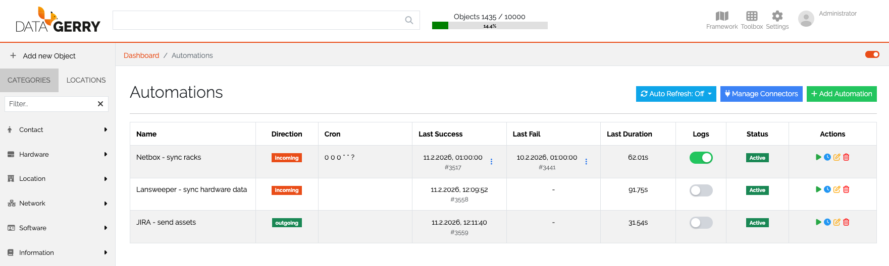
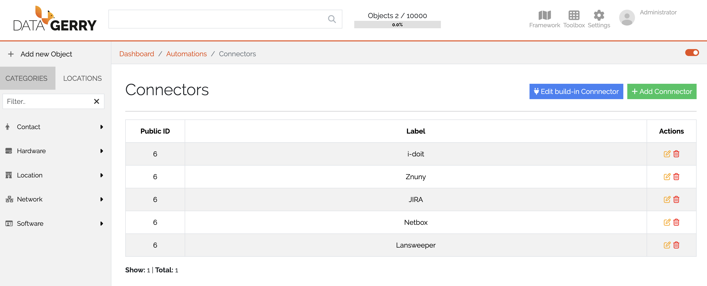

.. _automations-anchor:

###########
Automations
###########

|licensed| — on self-hosted installations this needs a license that includes Automations;
in the cloud it is part of the subscription. See :doc:`../start/editions`.

.. contents::
   :local:

Automations exchange data between DataGerry and other systems on a schedule. You build
and manage them in DataGerry's interface; in the background,
`OpenCelium <https://opencelium.io>`_ runs the connections. For everything about the
editor itself — methods, references, logic blocks — see the
`OpenCelium documentation <https://docs.opencelium.io>`_.

.. admonition:: Cloud and self-hosted
   :class: edition

   In the cloud, OpenCelium is provided by the service and OpenCelium licensing is handled
   by your subscription — there is no license page. The built-in connector needs an
   **x-api-key** instead of a URL, and you get both the API key and the connector master
   password from the `DataGerry Service Portal <https://service.datagerry.com>`_.

   On a self-hosted installation DataGerry connects to your own OpenCelium instance,
   configured in the ``[OpenCelium]`` section of the configuration file (``host``,
   ``port``, ``protocol``, ``email``, ``user``, ``password``; see
   :doc:`../operations/configuration`). Without it, the Automations page reports a missing
   configuration. The built-in connector needs the **URL** of the DataGerry instance.
   **View Licenses** on the Automations page shows the OpenCelium license: type, status,
   validity, the current monthly period and the operation usage against the limit, also
   per connection.

Terms
=====

Automation
   A connection plus a schedule entry: a task that runs on a cron schedule and moves data
   through connectors.

Automation-IDE
   The editor in which automations are built (in OpenCelium: the connection editor).
   Templates can be loaded there as a starting point, modified and saved.

Connector
   The access to one system — DataGerry itself or a third-party application.

Invoker
   The API definition of a third-party application. It tells the connector how to
   authenticate and which API methods are available in the Automation-IDE.

The automation list
===================

Go to **Toolbox → Automations**. The table shows per automation:

.. list-table::
   :header-rows: 1
   :widths: 22 78

   * - Column
     - Meaning
   * - **Name**
     - The automation's name.
   * - **Direction**
     - Incoming or outgoing data flow.
   * - **Connector**
     - The connector the data comes from or goes to.
   * - **Cron**
     - The schedule.
   * - **Last Success** / **Last Fail**
     - Time of the last successful and failed run.
   * - **Last Duration**
     - Duration of the last run.
   * - **Logs**
     - Switch detailed logging on or off; open the **Log list**.
   * - **Status**
     - **Active** or **Inactive**.
   * - **Actions**
     - Run now, **Edit Automation**, **Set Cron Job**, **Delete Automation**.

**Auto Refresh** reloads the list every 15 s, 30 s or 1 min (or **Off**); **Refresh now**
reloads once.

   The automation list.

Access is controlled by the ``base.openCelium.connection.*`` rights (view, add, edit,
delete) for automations and ``base.openCelium.connector.*`` for connectors. See
:doc:`../reference/rights`.

Add an automation
=================

1. Click **Add Automation**.
2. Fill in the form:

   * **Name**.
   * **Direction of data flow** — **Incoming Data** or **Outgoing Data**.
   * **Get data from Connector** / **Send data to Connector** — the connector, depending
     on the direction.
   * **Use a predefined interface template** — optional. The templates offered depend on
     the connector and direction. A template is an interface blueprint that opens in the
     Automation-IDE as a starting point.

3. Build the automation in the Automation-IDE and save it. How to work with methods,
   references and operators is described in the
   `OpenCelium documentation <https://docs.opencelium.io>`_.
4. Set the schedule with **Set Cron Job**: use the generator (every X minutes, or minute,
   hour, day of month, day of week) or enter a Quartz cron expression manually.

When the automation uses the built-in DataGerry connector, you may be asked for the
connector's password before you can continue.

Manage connectors
=================

**Manage Connectors** on the Automations page lists the connectors used by automations.

   Managing connectors.

The built-in connector
----------------------

The built-in connector is DataGerry itself, used when an automation reads from or writes
to this installation. Set it up with **Edit build-in Connnector**: enter **Username** and
**Password** of a DataGerry user, plus the URL or API key described in the callout at the
top of this page.

Add a connector
---------------

Click **Add Connnector**. The form has two parts:

* **General data** — title, **Invoker**, timeout and **Disable SSL Validation**.
* **Credentials** — the authentication fields of the selected invoker, for example API
  URL, username and password, or API token. A **Configuration Help** text explains them.

Before you can save, click **Test Connection**: only a connector whose test call succeeds
can be saved and used.

To show the stored credentials of an existing connector, enter the **Master Password**.
