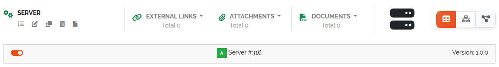
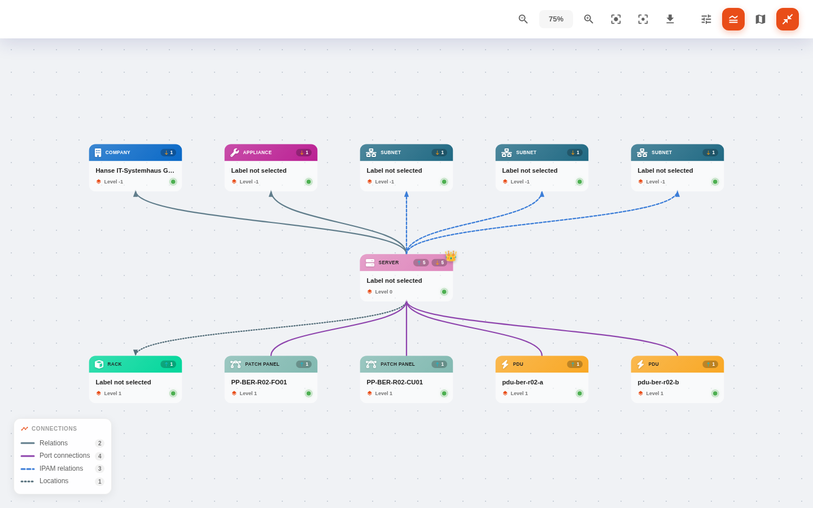
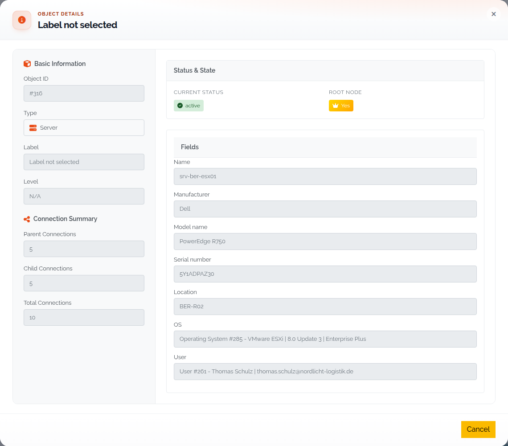
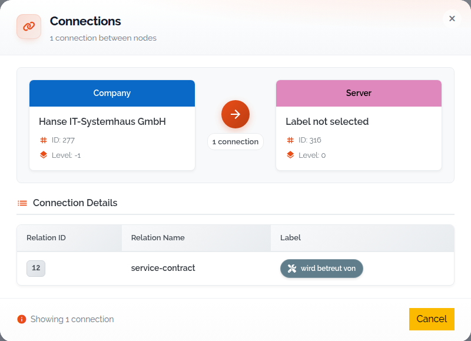
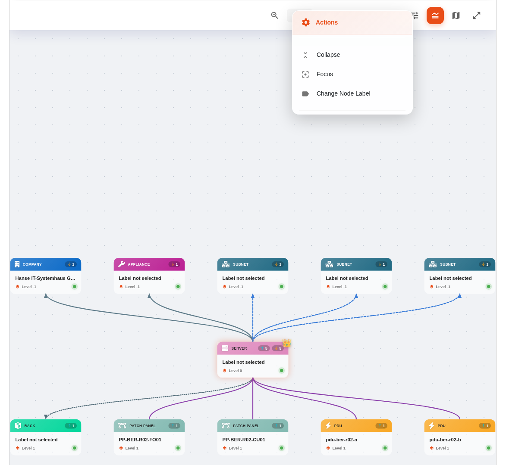
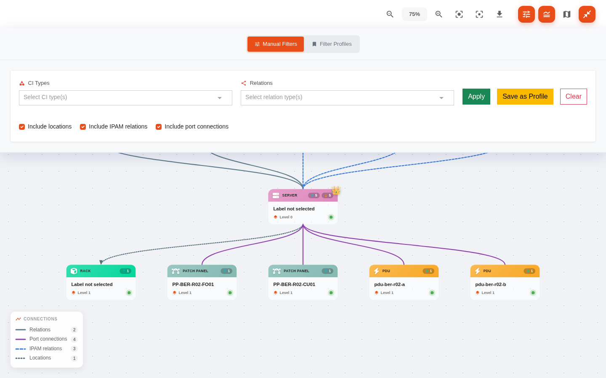
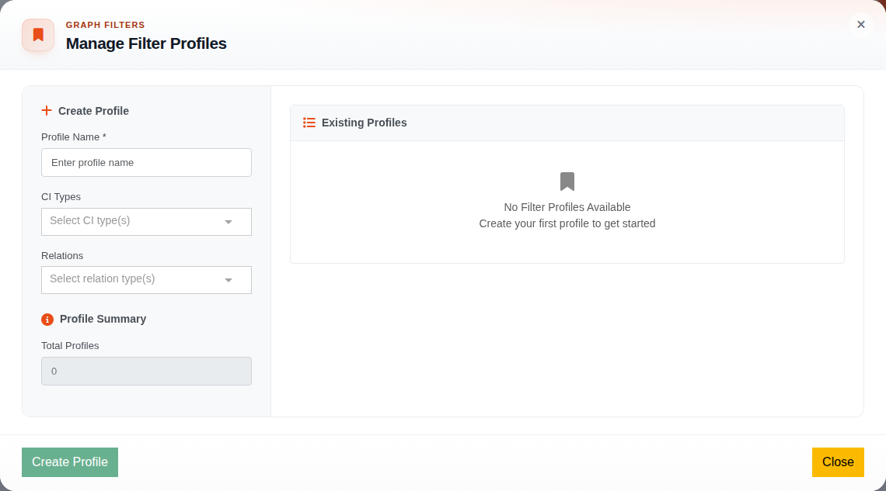

.. _ci-explorer-anchor:

###########
CI Explorer
###########

.. contents::
   :local:

The CI Explorer draws an object and the objects connected to it as an interactive
graph. Use it to follow dependencies across several levels, judge the impact of a
change, find wrongly set relations, or map dependencies for planning and audits.
It shows what you have modelled as relations (:doc:`../concepts/relationships`),
plus, if you include them, locations, IPAM references and port connections.

Open the CI Explorer
====================

* **From an object** — in the object view, click **Graph View** (the diagram icon
  in the view switch at the top right).
* **From the Toolbox** — open **Toolbox → CI Explorer**, select an object and
  click **Open**.

Inside the graph view, **Select Object:** at the top lets you pick another object;
**Open** jumps to it.

   Opening the CI Explorer from the object view.

Read the graph
==============

The selected object is the **root node** in the centre. Parent objects are drawn
above it, child objects below. Each node shows badges with the number of parent
and child connections.

   An object and its relations.

The node colour is the type's **Color**, set in the type configuration. The node's
name comes from the type's label field (see :ref:`ci-explorer-node-label`).

Connections are drawn differently by kind; **Toggle Legend** in the toolbar shows
the legend **Connections** with a count per kind:

* **Relations**
* **Port connections** *(3.3)* — drawn as undirected lines without an arrow head.
  If two objects are both related and cabled, the cable is drawn.
* **IPAM relations**
* **Locations**

Navigate
========

* **Click a node** to open its object details.
* **Click a connection** to see the relations between the two nodes (relation ID,
  name and label).
* **Expand a node** with the toggle on the node, or with **Expand** in its context
  menu, to load the next level: parents of a parent, children of a child. You can
  keep expanding without limit. **Collapse** hides the level again.

   Object details of a node.

   Relation details between two nodes.

Right-click a node for the context menu:

* **Set as Root Node** — make this object the centre of the graph.
* **Expand** / **Collapse** — load or hide the next level.
* **Focus** — centre the view on the node.
* **Change Node Label** *(3.3)* — see below.

   The node context menu.

.. _ci-explorer-node-label:

Change the node label
---------------------

*(3.3)* **Change Node Label** opens **Node Label:** *<type>*. Pick the **Label
field** whose value names every node of that type; a preview shows the result on
the selected node. **Save** changes the type's CI Explorer label, so it applies to
all objects of the type, everywhere. You can also set it in the type
configuration (**Select label for CI Explorer**).

Tools
=====

The toolbar at the top right holds:

.. list-table::
   :header-rows: 1
   :widths: 30 70

   * - Tool
     - Effect
   * - **Zoom In** / **Zoom Out**
     - Change the zoom level (``Ctrl++`` / ``Ctrl+-``, or ``Ctrl`` + mouse wheel).
   * - **Reset View**
     - Reset zoom and position (``Ctrl+0``).
   * - **Focus Mode**
     - Dim everything except the current object and its connections.
   * - **Export full graph as PNG**
     - Download the whole graph as an image.
   * - **Toggle Filters**
     - Show the filter bar (see below).
   * - **Toggle Legend**
     - Show the connection legend.
   * - **Toggle Minimap**
     - Show a map of the whole graph; click in it to jump there.
   * - **Maximize to fullscreen**
     - Use the whole screen.

Filter the graph
================

**Toggle Filters** opens the filter bar with two modes:

* **Manual Filters** — choose **CI Types** and **Relations**, then **Apply**.
  **Clear** removes the filter, **Save as Profile** stores it.
* **Filter Profiles** — **Select Profile**, then **Apply Profile**.

In both modes, check boxes set what else the graph includes: **Include
locations**, **Include IPAM relations** and **Include port connections** *(3.3)*.

Manage profiles
---------------

A profile is a named filter of CI types and relations, for example "only servers
and applications, only *depends on* and *hosts*". **Manage Profiles** opens the
profile manager, where you create, edit and delete profiles (**Profile Name**,
**CI Types**, **Relations**).

   The profile manager.

   Editing saved profiles.

Rights
======

*(3.3)* The CI Explorer is gated by two rights:

.. list-table::
   :header-rows: 1
   :widths: 40 60

   * - Right
     - Allows
   * - ``base.framework.ciExplorer.view``
     - The **Graph View** button, the **Toolbox** entry and the graph itself.
   * - ``base.framework.ciExplorer.edit``
     - **Save as Profile**, **Manage Profiles** and **Change Node Label**.

See :doc:`../reference/rights`.
