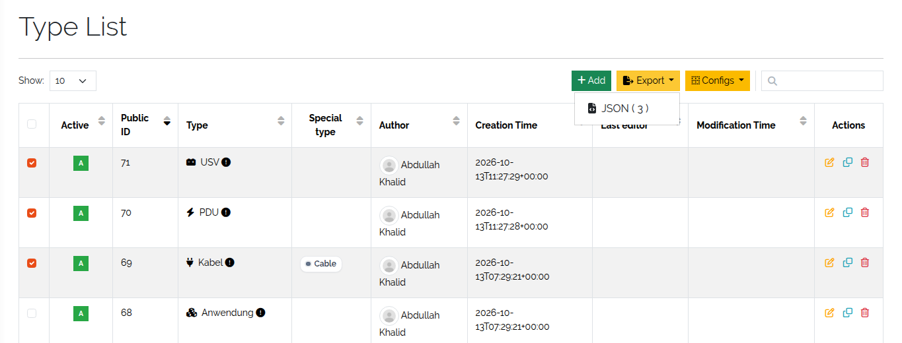
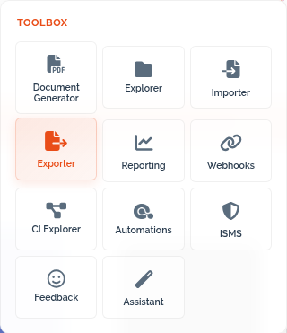
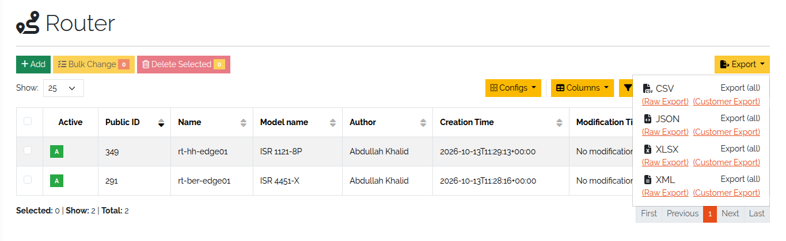

.. _exports-anchor:

###########
Export data
###########

.. contents::
   :local:

You export types and objects from **Toolbox → Exporter** or directly from the type and
object lists. Exports serve as backups, for migrating between installations, for reporting,
and as the starting point for imports (:doc:`import-data`).

Exporting is gated by its own rights *(3.3)*: ``base.export.type.*`` for types and
``base.export.object.*`` for objects and CSV templates. See :doc:`../reference/rights`.
Exported files are named ``<timestamp>_<kind>_<subject>[_readable].<extension>`` *(3.3)*,
for example ``2026_07_21-13_05_00_objects_router.csv`` or
``2026_07_21-13_05_00_types_47.json``, so they sort chronologically and can be identified
without opening them.

Export types
============

Types are exported as **JSON** with their full definition. The file has the format the
type import expects, so you can move types between installations.

* **From the Exporter** — **Toolbox → Exporter → Export Types**. Under **Select Types**
  pick one or more types (or select all), set **Output format** to ``json`` and click
  **Export**.
* **From the type list** — **Framework → Types**. Select types with the checkboxes and
  click **Export**. Without a selection, all types are exported.

   Several types selected for export in the type list.

Export objects
==============

Objects can be exported in these formats:

.. list-table::
   :header-rows: 1
   :widths: 15 85

   * - Format
     - Notes
   * - **CSV**
     - One type per file. Can be re-imported. Supports **Human readable**.
   * - **XLSX**
     - Microsoft Excel; one sheet per type. Supports **Human readable**.
   * - **JSON**
     - Several types in one file. The format the JSON object import expects.
   * - **XML**
     - Several types in one document; each object carries only its own type's fields.
   * - **ZIP**
     - Packs the export into an archive with one file per type.

Exports use the field label in column headers *(3.3)*. CSV, XLSX and XML exports include
:doc:`multi data sections <multi-data-sections>` *(3.3)*; in CSV an object with several
section entries spans several rows — the layout is described in :doc:`import-data`.
JSON exports contain them as well.

From the Exporter
-----------------

**Toolbox → Exporter → Export Objects**:

1. **Select Object Type**.
2. Choose the **Output format**.
3. For CSV and XLSX, optionally tick **Human readable** *(3.3)*.
4. Click **Export**.

   Object export in the Toolbox.

**Human readable** produces a file for people rather than for re-import: column headers
show field labels only, reference fields show the summary line of the referenced object,
and location fields show the location name. The UI marks it as a report-only export — the
file can't be used to re-import objects.

From the object list
--------------------

Open the object list of a **single type** and click **Export**. The menu is not available
when the list contains several types. Each format offers two modes; the label shows
whether all objects or only the selected ones (**Export (n)**) are exported.

.. list-table::
   :header-rows: 1
   :widths: 25 75

   * - Mode
     - Result
   * - **Raw Export**
     - All fields of the objects in their stored form. Use it to edit data and re-import
       it with as few formatting issues as possible.
   * - **Customer Export**
     - Only the columns shown in the table, and with a quick filter only the filtered
       objects. Values are exported rendered, as you see them — readable, but not meant
       for re-import.

   The export menu of an object list.

.. _export-csv-template:

Export a CSV template
=====================

*(3.3)* A CSV template is an empty file with only the header row of a type — the quickest
way to prepare an object import.

1. Go to **Toolbox → Exporter → Export CSV Templates**.
2. **Select Object Type** and click **Export**.
3. Fill in your data below the header row. Keep the headers unchanged.

The page explains the column layout, including multi data sections spread over several
rows, and links to the object import (**Go to object import**). The rules are summarized
in :doc:`import-data`.
