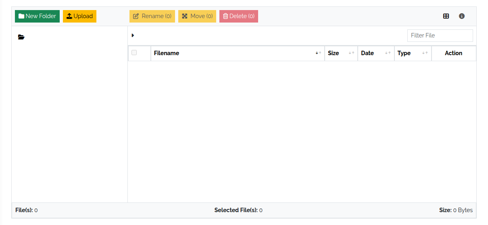

.. _file-explorer-anchor:

#############
File Explorer
#############

.. contents::
   :local:

The File Explorer stores files in a folder tree inside DataGerry — documentation,
templates, evidence for ISMS audits, and the files attached to objects. Open it with
**Toolbox → Explorer**.

The file store has no rights of its own: users who may view objects
(``base.framework.object.view``) can see and download files, users who may edit objects
(``base.framework.object.edit``) can upload, change and delete them. The **Explorer** menu
entry is shown with the edit right. See :doc:`../reference/rights`.

The layout
==========

* **Left** — the folder tree. Initially only the root folder exists.
* **Right** — the files of the selected folder with **Filename**, **Size**, **Date**,
  **Type** and actions. The footer shows the number of files and the count and size of the
  selected ones.

   The File Explorer.

Folders and uploads
===================

Above the folder tree:

* **New Folder** — creates a subfolder in the selected folder.
* **Upload** — uploads one or more files into the selected folder.

Names must be unique within a folder.

Work with files and folders
===========================

Per file, the action icons **Download**, **Rename**, **Move to** and **Delete** are
available. With the buttons above the list you can **Move** or **Delete** several selected
files at once; **Rename** works on one selected file. Folders can be renamed, moved and
deleted as well.

With one file selected, the info button above the list shows its details: type, size,
path, the object it is attached to (**Reference**), the user who last modified it and
when.

.. warning::
   Deleting a folder also deletes everything in it, including subfolders and files. It
   can't be undone.
