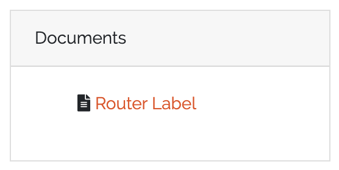

.. _document-generator-anchor:

##################
Generate documents
##################

|licensed| — on self-hosted installations this needs a license that includes the Document
Generator; in the cloud it is part of the subscription. See :doc:`../start/editions`.

.. contents::
   :local:

The Document Generator turns CMDB data into PDF documents. You design a **document
template** once — layout, text and placeholders for object data — and then download the
PDF for any object of the template's type.

How it works
============

A document template has three parts:

* the **template type** and its parameters — which objects the template is for,
* the **content** — designed in a WYSIWYG editor and stored as HTML, with template
  variables wherever CMDB data should appear,
* optional **custom CSS** for styling.

When a document is rendered, the variables are replaced with the object's values, HTML and
CSS are combined, and a PDF is generated with the
`xhtml2pdf <https://xhtml2pdf.readthedocs.io/en/latest/>`_ library.

Rights
======

Access is gated by these rights *(enforced on all routes and menus in 3.3)*:

.. list-table::
   :header-rows: 1
   :widths: 40 60

   * - Right
     - Allows
   * - ``base.docapi.template.view``
     - See the template list and render documents.
   * - ``base.docapi.template.add``
     - Create templates.
   * - ``base.docapi.template.edit``
     - Edit templates.
   * - ``base.docapi.template.delete``
     - Delete templates.

Unless you changed the defaults, the admin group has all of them and the user group has
``base.docapi.template.view``. See :doc:`../reference/rights`.

Create a template
=================

Go to **Toolbox → Document Generator** and add a template, or edit an existing one. A
wizard with four steps guides you.

1. **Template Settings** — a unique **Label** (the display name shown to users) and
   **Name**, an optional **Description**, and **Active by default**.
2. **Template Type** — choose the **Template Type** and the **Object Type** the template
   is for.

   * **Default Template** — the current template type.
   * **Object Template (Deprecated)** — the earlier type. It can no longer be selected for
     new templates; existing ones keep working and can still be edited. It doesn't offer
     the additional editor functions described below.

3. **Template Content** — design the document in the editor (see below). You can also edit
   the HTML source directly.
4. **Template Custom Style** — optional custom CSS. Leave it empty to keep the default
   styling. The step lists which CSS properties the PDF renderer supports.

Design the content
------------------

The editor toolbar adds these functions:

.. list-table::
   :header-rows: 1
   :widths: 25 75

   * - Button
     - Purpose
   * - **CMDB Data**
     - Insert data: **Object Data** (fields of the object, of referenced objects up to
       three levels deep, multi data section fields, and **Relations**), **Barcode** (QR
       or Code 128), **External objects** (a field of one fixed object, independent of the
       rendered one) and **Report** (the result table of a :doc:`report <reports>`).
   * - **Template Context**
     - Insert metadata and pagination placeholders: **Author**, **Template Label**,
       **User Display Name**, **Current Time**, **New Page**, **Current Page Count**,
       **Total Page Count**.
   * - **Document Options**
     - Page-level settings — see below.
   * - **AI Assistant**
     - Draft content from a text prompt — see :ref:`docgen-ai-assistant`.
   * - **Preview**
     - Render the template as PDF for an object you pick.

**Relations**, **External objects**, **Report**, **Template Context**, **Document
Options** and the **AI Assistant** are available for Default Templates only.

Template variables
~~~~~~~~~~~~~~~~~~

The **CMDB Data** menu inserts the correct syntax for you. For reference, in a Default
Template:

.. code-block:: text

   # public ID of the rendered object
   {{root.public_id}}

   # field "hostname" of the rendered object
   {{root.fields['hostname']}}

   # a field of a multi data section
   {{root.mds['interfaces']['ip_address']}}

   # field "hostname" of the fixed object 42
   {{ object(42).fields['hostname'] }}

   # template context
   {{author}}  {{current_time}}  {{current_page_count}} / {{total_page_count}}

In a deprecated Object Template the variables have no ``root.`` prefix:

.. code-block:: text

   {{id}}
   {{fields['hostname']}}

   # dereference the reference field "location" (up to three levels)
   {{fields['location']['fields']['city']}}

.. note::
   Variables use the field **name**, not the label.

Document options
~~~~~~~~~~~~~~~~

**Document Options** opens a dialog with these tabs; **Apply** stores them with the
template.

.. list-table::
   :header-rows: 1
   :widths: 25 75

   * - Tab
     - Settings
   * - **General**
     - Page margins top, bottom, left and right in mm, with a live preview.
   * - **Cover Page**
     - **Activate cover page** and its content.
   * - **Table of Contents**
     - **Activate table of contents**, line spacing, and per heading level the style
       (bold, italic, colour), indent level and space above.
   * - **Header** / **Footer**
     - **Activate header** / **Activate footer** and the content repeated on every page.

.. _docgen-ai-assistant:

Draft content with the AI Assistant
-----------------------------------

The **AI Assistant** button (tooltip *AI Assistant (using OpenAI API)*) drafts template
content with OpenAI:

1. **Describe your content** — enter a prompt (up to 4,000 characters) or start from an
   example. Name the CI type, list the fields to include and describe the layout — a table,
   sections or lists.
2. **Review & insert** — click **Generate**, check the result as **Preview** or **HTML**,
   **Regenerate** if needed, then **Insert** it into the editor.

The assistant writes placeholders in the form ``[[Contact Name]]`` where data from the
CMDB belongs; replace them with template variables from **CMDB Data**. Your prompt is sent
to OpenAI.

If no API key is set up, the button shows **AI Assistant unavailable** instead *(3.3)*.
Errors from the backend are shown in the dialog.

.. admonition:: Cloud and self-hosted
   :class: edition

   In the cloud, the AI Assistant is set up by the service. On a self-hosted installation
   an administrator adds an OpenAI API key to the configuration file and restarts
   DataGerry:

   .. code-block:: ini

      [ChatGPT]
      api_key = <your OpenAI API key>

   The shipped ``cmdb.conf`` contains this section with a placeholder value; replace it
   with a real key, otherwise generation fails with an error from OpenAI. See
   :doc:`../operations/configuration`.

Generate a document
===================

Open an object. The **Documents** box in the object view lists the active templates for
the object's type; click one to download the PDF. Without the license feature, the box
shows a **Pro** badge.

   The Documents box of an object.

Advanced styling
================

Only a limited CSS subset is supported by the PDF renderer. **Template Custom Style** lists
the supported properties; unsupported are, among others, flexbox, grid, ``float``,
``margin-*`` properties, ``border-radius``, shadows, transforms and media queries. For
details see the `xhtml2pdf documentation <https://xhtml2pdf.readthedocs.io/en/latest/>`_.

Page format
-----------

The default page format is A4 portrait. Set margins in **Document Options → General**;
change paper size and orientation with ``@page``:

.. code-block:: css

   @page {
       /* a0–a6, portrait or landscape */
       size: a6 landscape;
   }

.. code-block:: css

   @page {
       /* size in mm */
       size: 80mm 60mm;
   }

Frames for custom layouts
-------------------------

xhtml2pdf positions content with frames. Give ``div`` elements an ID in the HTML:

.. code-block:: html

   

       

   

   

       

   

and position them in the CSS:

.. code-block:: css

   @page {
       @frame header_left {
           left: 0px;
           top: 0px;
           width: 300px;
           height: 100px;
           -pdf-frame-content: header_left;
       }

       @frame header_right {
           left: 400px;
           top: 0px;
           width: 300px;
           height: 100px;
           -pdf-frame-content: header_right;
       }
   }

Custom fonts
------------

Make the font files reachable for the DataGerry server over HTTP and embed them with
``@font-face``:

.. code-block:: css

   @font-face {
       font-family: 'RalewayRegular';
       src: url('http://127.0.0.1:8000/Raleway-Regular.ttf');
   }

   p {
       font-family: 'RalewayRegular';
   }
