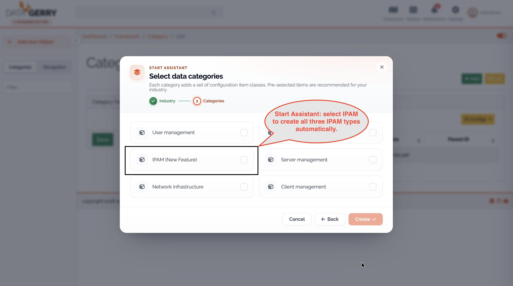
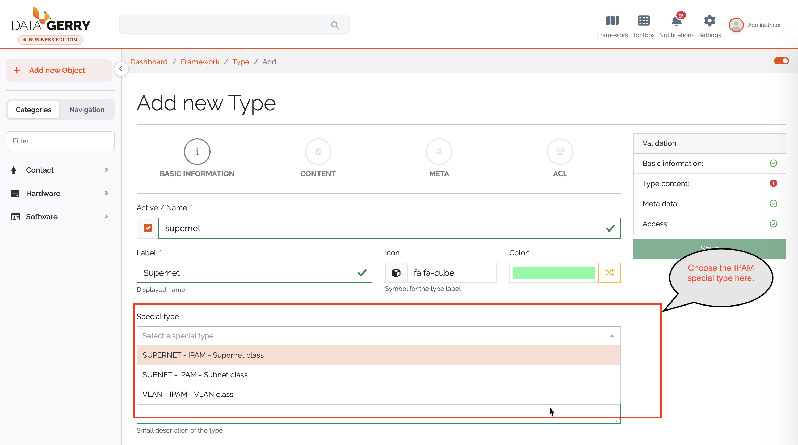
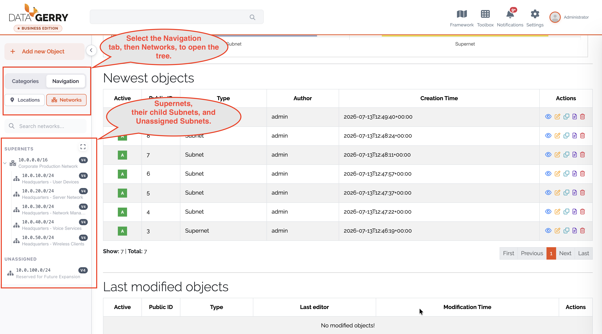
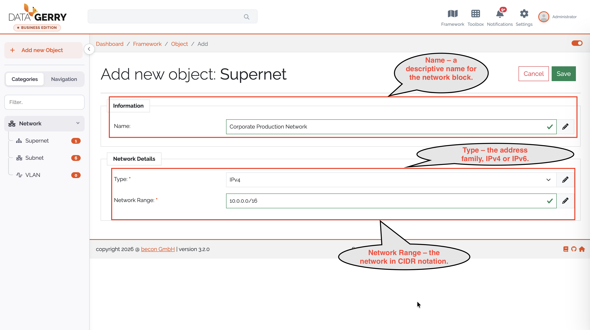
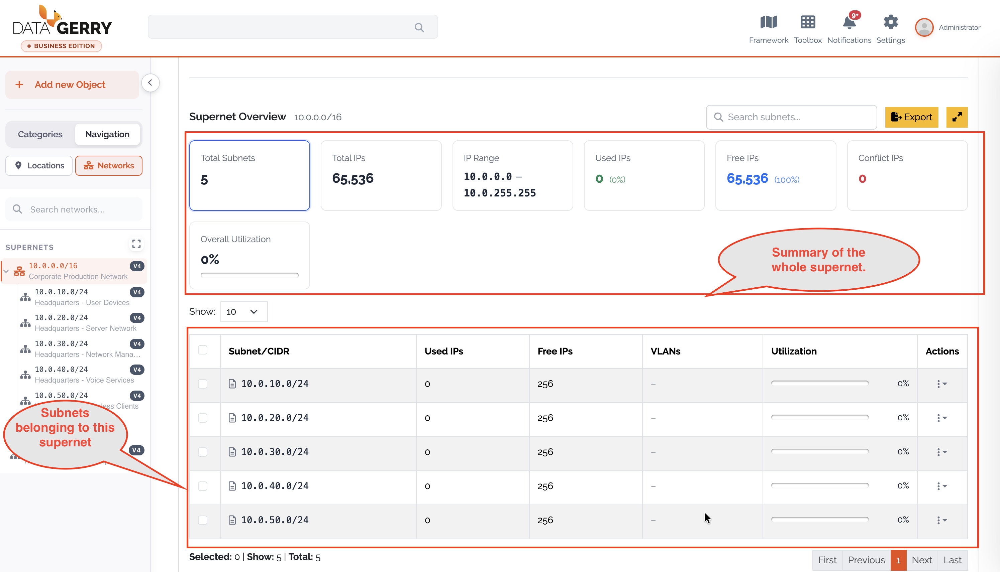
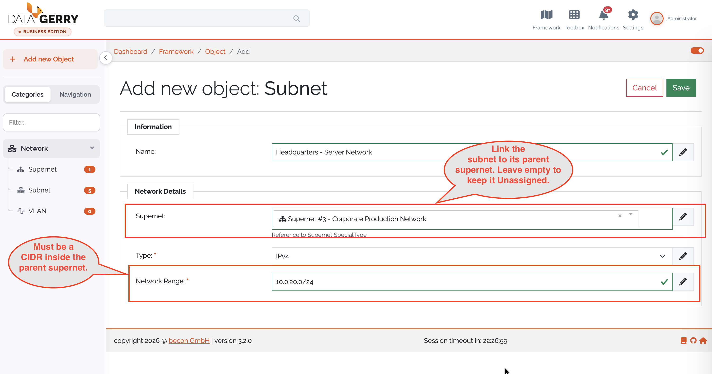
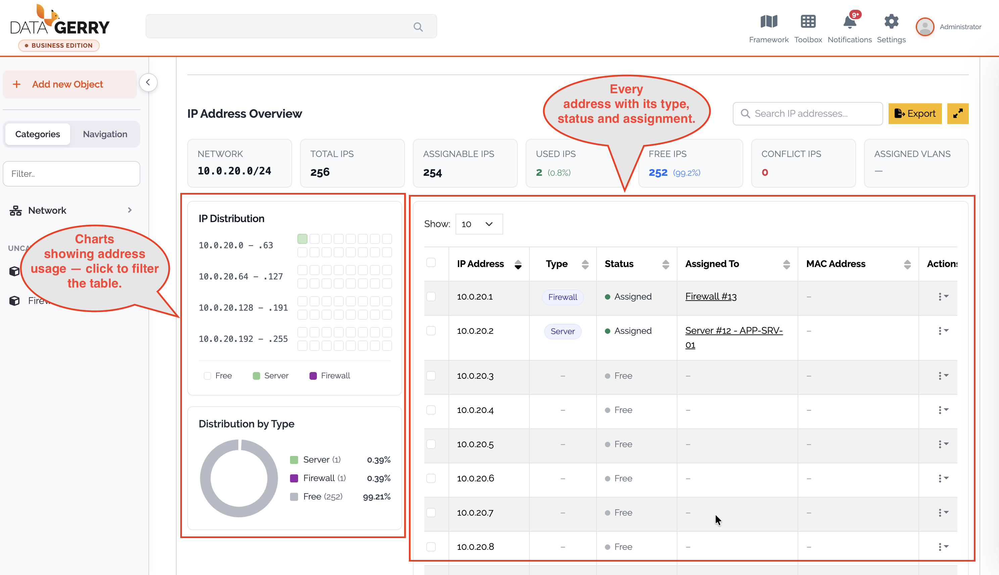
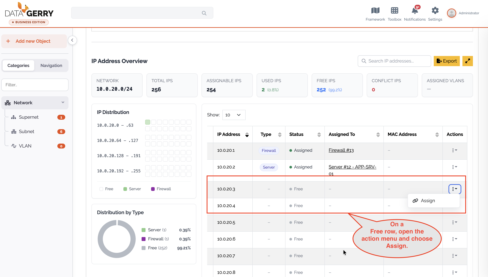
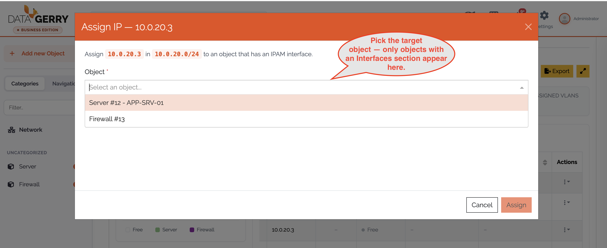
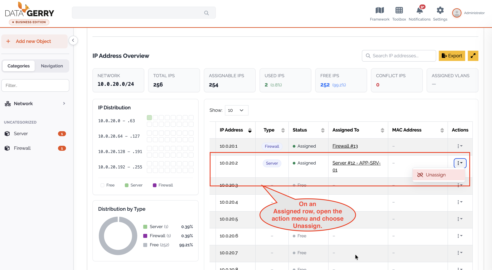

.. _ipam-anchor:

####
IPAM
####

|licensed| — on self-hosted installations this needs a license that includes
IPAM; in the cloud it is part of the subscription. See :doc:`../start/editions`.

.. contents::
   :local:

IP Address Management (IPAM) tracks your address space inside the CMDB. You
register large network blocks (supernets), divide them into subnets, and see which
addresses are used or free and which object uses each one. This page assumes you
know types, objects and section templates (:doc:`../guides/model-types`,
:doc:`../guides/work-with-objects`).

.. admonition:: Cloud and self-hosted
   :class: edition

   In the cloud, IPAM is available depending on your subscription. On a
   self-hosted installation it is unlocked by a license that includes the IPAM
   feature. Without it, the IPAM special types
   are shown as locked with **Upgrade to unlock**, and the **Networks** tree in
   the sidebar shows the same hint. The same license feature also unlocks
   :doc:`racks` and :doc:`ports-and-cabling`.

How IPAM is organised
=====================

IPAM has no separate data store. Its entities are ordinary objects of dedicated
**special types**; the reference fields between them are wired automatically when
you create the types.

.. list-table::
   :header-rows: 1
   :widths: 20 80

   * - Entity
     - What it is
   * - **Supernet**
     - A top-level network block, e.g. ``10.0.0.0/8``, with an address family
       (IPv4 or IPv6) and a range in CIDR notation.
   * - **Subnet**
     - A range inside a supernet, e.g. ``10.0.1.0/24``. The parent supernet is
       optional; a subnet without one is listed as *Unassigned*.
   * - **VLAN**
     - Optional. References a subnet and records VLAN information (Static /
       Dynamic).
   * - **Interface**
     - An entry of the predefined **Interfaces** section template, a
       :ref:`multi-data section <mds-anchor>`. This is how a regular object
       (server, client, router …) claims IP addresses.

The links are plain references: **Subnet → Supernet**, **VLAN → Subnet** and
**Interface → Subnet**. An address counts as *used* exactly when an interface
entry on some object references its subnet and holds that address.

.. _ipam-setup-anchor:

Set up IPAM
===========

The three special types **Supernet**, **Subnet** and **VLAN** must exist first.
Create them in one of two ways:

* **Start Assistant** — the **IPAM** profile of the :ref:`Start Assistant
  <datagerry-assistant-anchor>` creates Supernet, Subnet and VLAN (in that order,
  so the references wire up) in a *Network* category.
* **Type builder** — when you create a type, choose the **Special type** in the
  basic step. The special type is assigned when the type is created and cannot
  be changed afterwards.

   Creating the IPAM types with the Start Assistant.

   Choosing a special type in the type configuration.

To let an object hold IP addresses, add the **Interfaces** section template to
its type.

Find your networks
==================

In the sidebar, open **Navigation → Networks**. The tree lists every supernet
(expand it for its subnets) and an **Unassigned** group for subnets without a
parent. Each node shows its CIDR, an IPv4/IPv6 badge and the object name;
**Search networks…** finds an entry.

   The Networks tree in the sidebar.

Click a node to open the object. IPAM has no page of its own — its overviews are
part of the object view, below the attributes: a supernet shows the **Supernet
Overview**, a subnet the **IP Address Overview**.

Register a supernet
===================

#. Create an object of your Supernet type.
#. Fill in the fields:

   * **Name** — a descriptive name for the block.
   * **Type** — the address family, *IPv4* or *IPv6* (required).
   * **Network Range** — the block in canonical CIDR notation, e.g.
     ``10.0.0.0/8`` (required).

#. Save. DataGerry checks that the range is a canonical CIDR and that **Type**
   matches the family of the range.

   Creating a supernet.

Supernet Overview
-----------------

* **Key figures** — Total Subnets, Total IPs, IP Range (first–last address), Used
  IPs, Free IPs and Conflict IPs. IPv4 supernets also show an **Overall
  Utilization** bar.
* **Subnet table** — the child subnets with CIDR, Used IPs, Free IPs, VLANs and,
  for IPv4, Utilization. Rows expand lazily to show nested subnets. A **Search
  subnets…** box and an **Export** button (CSV) are available.
* **Unassign subnets** — the row action, or a bulk action on selected rows,
  removes subnets from this supernet after a confirmation. The subnet's parent
  reference is cleared and it becomes *Unassigned*; it is not deleted.

   The Supernet Overview.

Register a subnet
=================

#. Create an object of your Subnet type.
#. Fill in the fields:

   * **Name** — a descriptive name.
   * **Supernet** — optional, the parent supernet.
   * **Type** — the address family, *IPv4* or *IPv6* (required).
   * **Network Range** — the subnet in canonical CIDR notation, e.g.
     ``10.0.1.0/24`` (required).

#. Save.

The **Network Range** is checked live against the server while you type: it must
be a canonical CIDR of the selected family and, if a supernet is set, lie inside
that supernet and not overlap a sibling subnet. The same checks run on save.

   Creating a subnet with live range validation.

IP Address Overview
-------------------

Opening a subnet shows every address of the subnet with its status.

* **Key figures** — Network (CIDR), Total IPs, Assignable IPs, Used IPs, Free IPs,
  Conflict IPs and Assigned VLANs.
* **Charts** — **IP Distribution** (a heatmap of the address range) and
  **Distribution by Type**.
* **IP table** — IP Address, Type, Status, Assigned To, MAC Address and Actions.
  Every column except Actions sorts; free addresses always sort last.

Narrow the table down by:

* clicking a sector of **IP Distribution** to drill into that range,
* clicking one or more types in **Distribution by Type**,
* toggling **Free** to show only unused addresses,
* searching (at least two characters; searches the whole subnet),
* clicking the **Conflict IPs** card to show only conflicts (see
  :ref:`ipam-conflicts-anchor`).

**Export** downloads the list as CSV.

   The IP Address Overview.

Assign an IP address
====================

From the subnet
---------------

#. In the IP Address Overview, find a row with status **Free** and choose
   **Assign**.
#. In the **Assign IP** dialog, select the **Object**. Only objects that have an
   **Interfaces** section are offered.
#. DataGerry prepares a new interface entry with **Active**, the address family
   (**Type**), the **Subnet** and the **IP address** filled in and locked. Fill in
   **Hostname**, **Domain** and **MAC-Address** if you want.
#. Click **Assign**. The entry is added and the object saved; existing interface
   entries are not touched.

   Starting the assignment from a free address.

   Selecting the target object.

.. figure:: ../img/ipam/ipam_assign_ip_3.png
   :width: 800

   The assigned address in the IP table.

On the object
-------------

Any object with the **Interfaces** section can manage its addresses directly. An
interface entry has these fields:

.. list-table::
   :header-rows: 1
   :widths: 25 75

   * - Field
     - Meaning
   * - **Active**
     - Whether the entry is active.
   * - **Type**
     - Address family (IPv4 / IPv6). Decides which subnets are offered; changing
       it clears the selected subnet.
   * - **Network**
     - The subnet, filtered by **Type**.
   * - **IP-Address**
     - The address (validated).
   * - **Hostname**, **Domain**, **Mac-Address**
     - Further details.

Interfaces can be linked to the object's ports *(3.3)* — see
:doc:`ports-and-cabling`.

Unassign an IP address
----------------------

For a row with an owner in **Assigned To**, choose **Unassign** (single row or a
bulk selection) and pick a mode:

* **Subnet** (default) — frees the address but keeps the interface entry; only
  the subnet reference is cleared.
* **Interface entry** — removes the whole interface entry from the object.

   Unassigning an IP address.

Validation rules
================

The same rules apply in the interface and on the server:

* **CIDR** — ranges must be canonical (host bits zero: ``10.0.0.0/24`` is valid,
  ``10.0.0.5/24`` is not). The prefix is an integer, ``/0``–``/32`` for IPv4 and
  ``/0``–``/128`` for IPv6.
* **IP addresses** — canonical IPv4 (dotted quad) or IPv6. IPv6 addresses are
  normalised on save so uniqueness checks are exact.
* **MAC addresses** — colon or hyphen separated (``00:1A:2B:3C:4D:5E``) or Cisco
  dotted (``001a.2b3c.4d5e``).
* **Address counting** — for IPv4, *Assignable IPs* excludes the network and
  broadcast address for ``/30`` and larger blocks; ``/31`` and ``/32`` follow
  RFC 3021. For IPv6 every address is assignable.
* **Uniqueness** — within a subnet, an address can be assigned only once across
  all objects' interface entries.

.. _ipam-conflicts-anchor:

Notes and limitations
=====================

* **Conflicts** — you may change a supernet's or subnet's range even if child
  subnets or assigned addresses end up outside it. Those entries are then flagged
  as **Conflict** so you can repair or unassign them; the **Conflict IPs** card
  counts them.
* **Delete guards** — a supernet cannot be deleted while a subnet references it;
  a subnet cannot be deleted while a VLAN or interface entry references it. VLANs
  can always be deleted.
* **IPv6** — percentages and utilisation bars are hidden, and large counts are
  shown in compact form.
* **Very large IPv4 subnets** — above ``/12``, search, sorting and filtering in the
  IP table are disabled for performance; you can still browse the addresses in
  ascending order.
* **Assignment prerequisite** — an object can only receive an address if its type
  has the **Interfaces** section.

Rights
======

IPAM uses the rights ``base.framework.ipam.view`` (overviews, the Networks tree,
validation) and ``base.framework.ipam.edit`` (for example unassigning subnets and
addresses), on top of the normal object rights. See :doc:`../reference/rights`.
