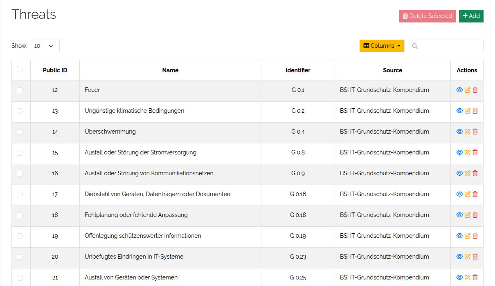
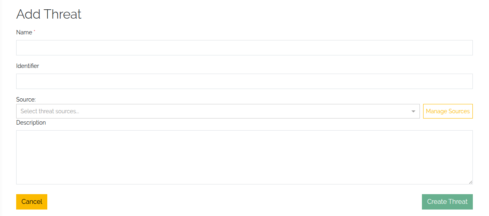
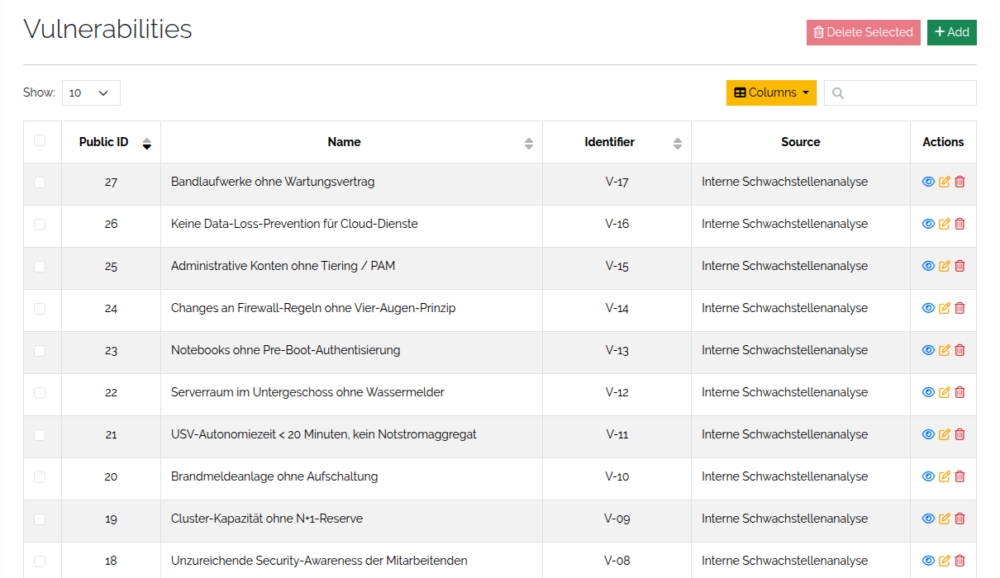
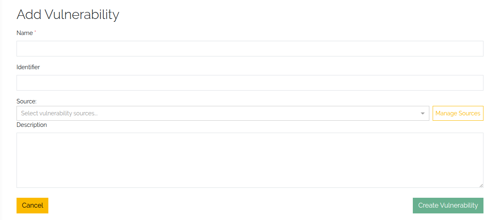
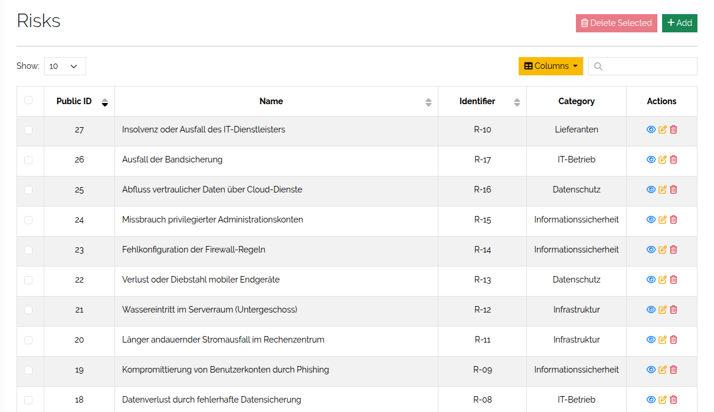
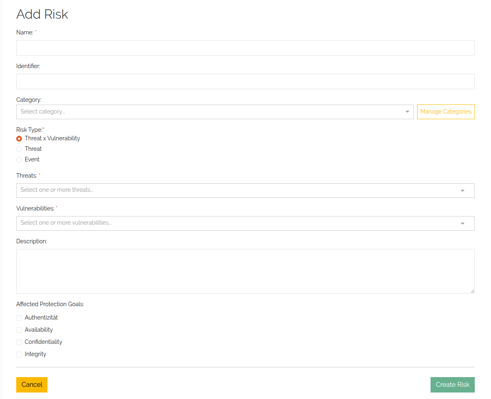
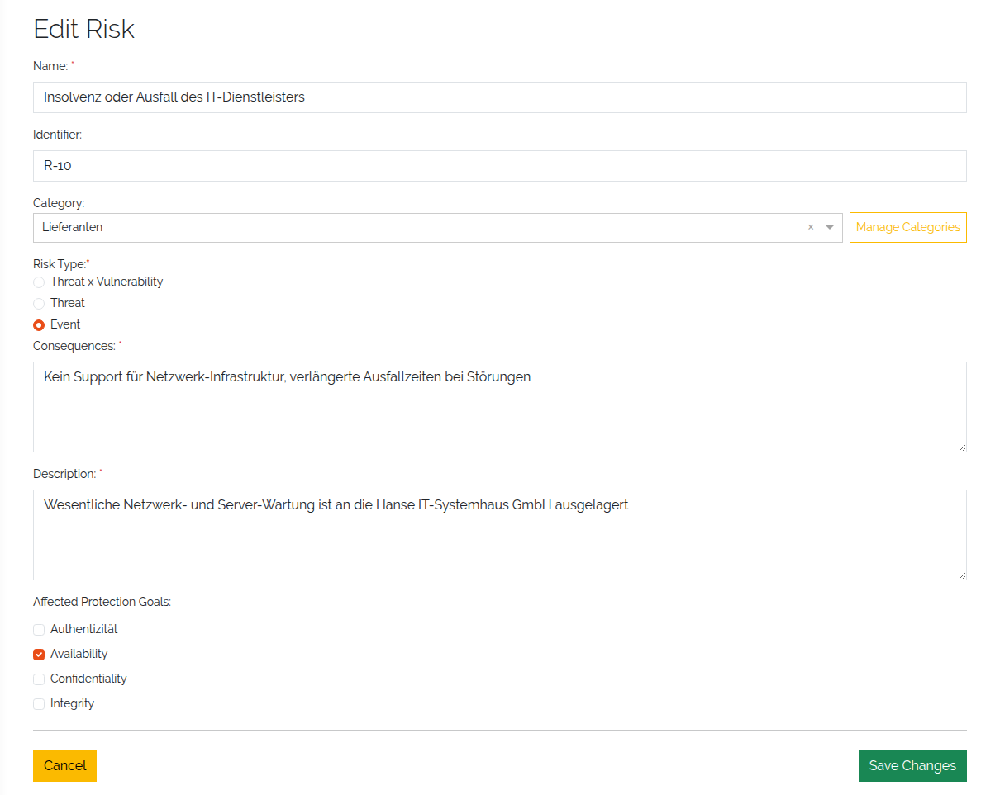
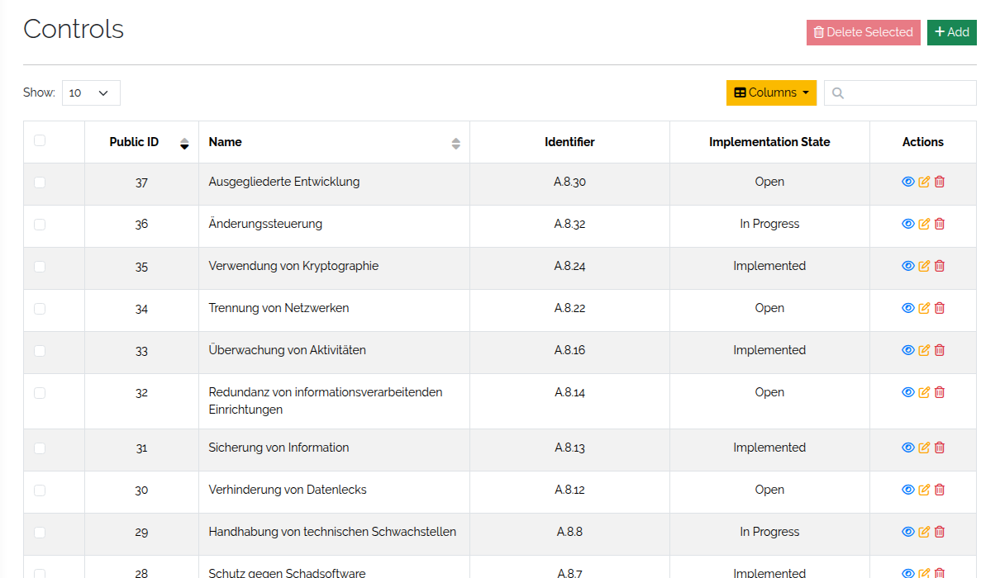
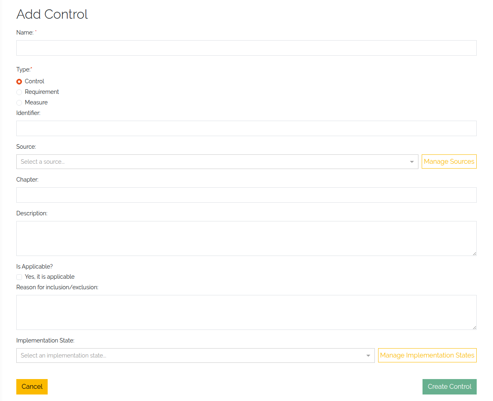

############################
Maintain the ISMS catalogues
############################

|licensed| — on self-hosted installations this needs a license that includes ISMS; in the cloud it is
part of the subscription. See :doc:`../start/editions`.

.. contents::
   :local:

The catalogues hold the reusable descriptions of what can go wrong — threats, vulnerabilities, risks —
and of what you do about it — controls. This page shows how to maintain them. For the model behind them
see :doc:`../concepts/isms`; to load many entries at once from CSV see
:doc:`../reference/isms-csv-import`.

All four catalogues are on the ISMS overview (**Toolbox → ISMS**). Each opens a list with search,
sorting and paging; the icons in a row view, edit or delete the entry, and **Add** creates a new one.

.. _isms-threat-anchor:

Threats
=======

Threats are potential causes of an unwanted incident that may harm a system, asset or organisation.
Create them before you create risks of type *Threat x Vulnerability* or *Threat*.

Open **Toolbox → ISMS → Threats**.

   The threats list.

.. list-table::
   :header-rows: 1
   :widths: 25 75

   * - Field
     - Description
   * - **Name**
     - Required. A short, descriptive name, e.g. *Malware Infection*, *Phishing Attack*.
   * - **Source**
     - Optional. Where the threat comes from or how it is classified. Pick a source from the list;
       **Manage Sources** adds or edits sources.
   * - **Identifier**
     - Optional. A reference such as *THR-001*.
   * - **Description**
     - A longer explanation of the threat and its potential impact.

   Creating a threat.

.. _isms-vulnerability-anchor:

Vulnerabilities
===============

Vulnerabilities are weaknesses in systems, processes or controls that a threat can exploit. They are used
in risks of type *Threat x Vulnerability*.

Open **Toolbox → ISMS → Vulnerabilities**.

   The vulnerabilities list.

.. list-table::
   :header-rows: 1
   :widths: 25 75

   * - Field
     - Description
   * - **Name**
     - Required. A short, descriptive name, e.g. *Outdated Software*, *Weak Password Policy*.
   * - **Source**
     - Optional. Where the vulnerability comes from or how it is classified. **Manage Sources** adds
       or edits sources.
   * - **Identifier**
     - Optional. A reference such as *VUL-001*.
   * - **Description**
     - A detailed explanation of the vulnerability and its implications.

   Creating a vulnerability.

.. _isms-risk-anchor:

Risks
=====

A risk describes a scenario that endangers the confidentiality, integrity or availability of
information. Risks are what you assess against your objects and object groups.

Open **Toolbox → ISMS → Risks**. The list shows all risks with their type, affected protection goals and
threat context.

   The risks list.

The fields shown in the form depend on the **Risk Type**, so you only capture what is relevant:

.. list-table::
   :header-rows: 1
   :widths: 25 75

   * - Field
     - Description
   * - **Name**
     - Required. The title of the risk.
   * - **Identifier**
     - Optional. A unique reference code for internal or regulatory use.
   * - **Category**
     - Required. Groups similar risks. **Manage Categories** adds or edits categories.
   * - **Risk Type**
     - Required; *Threat x Vulnerability* is preselected. Controls which of the following fields apply:

       * *Threat x Vulnerability* — **Threats** and **Vulnerabilities** are required.
       * *Threat* — **Threats** is required.
       * *Event* — **Consequences** and **Description** are required.
   * - **Threats**
     - The threats that contribute to the risk.
   * - **Vulnerabilities**
     - The weaknesses the threats can exploit.
   * - **Consequences**
     - Free text: what happens if the risk materialises.
   * - **Description**
     - A detailed explanation of the risk scenario.
   * - **Affected Protection Goals**
     - Check every protection goal the risk can affect, e.g. *Confidentiality*, *Integrity*,
       *Availability*.

   Creating a risk.

   A configured risk.

The detail view of a risk also lists its risk assessments — see :doc:`isms-risk-assessments`.

.. _isms-controls-anchor:

Controls
========

Controls are actions, procedures or mechanisms that reduce or eliminate risks. They can come from
internal policies, regulations or standards such as ISO/IEC 27001. You link them to risk assessments as
part of risk treatment (see :doc:`isms-risk-assessments`).

Open **Toolbox → ISMS → Controls**.

   The controls list.

.. list-table::
   :header-rows: 1
   :widths: 25 75

   * - Field
     - Description
   * - **Name**
     - Required. The title of the control, e.g. *Access Control Policy*, *Regular Patch Management*.
   * - **Type**
     - Required. The role or origin of the entry:

       * *Control* — a concrete safeguard that mitigates identified risks, e.g. *Firewall
         configuration*, *Password complexity enforcement*.
       * *Requirement* — a binding obligation, often from regulations, frameworks or policies, e.g.
         *Access logging must be retained for 6 months*, *Data must reside in the EU*.
       * *Measure* — a supportive or strategic activity, e.g. *Annual awareness training*,
         *Third-party risk review*.
   * - **Identifier**
     - A unique reference, e.g. *CTRL-001* or *A.5.1*.
   * - **Source**
     - Where the control comes from, e.g. a framework such as *ISO 27001:2022*. **Manage Sources**
       maintains the list.
   * - **Chapter**
     - The section of the standard, framework or policy the control relates to, e.g. *A.9.1.1*.
   * - **Description**
     - What the control is and how it mitigates risk.
   * - **Is Applicable?**
     - Whether the control applies to your organisation or context.
   * - **Reason for inclusion/exclusion**
     - Why the control is or is not applicable, e.g. *Not applicable due to cloud hosting model*.
   * - **Implementation State**
     - The overall implementation status, e.g. *Planned*, *In Progress*, *Implemented*.
       **Manage Implementation States** maintains the list.

   Creating a control.

Controls with the source *ISO 27001:2022* lead the Statement of Applicability — see
:doc:`isms-reports`.

Delete entries
==============

To delete a single entry, use the delete icon in its row. *(3.3)* To delete several at once, select them in the
list of threats, vulnerabilities, risks or controls and click **Delete Selected**; the button shows how
many are selected. Changing the page, page size, sort order or search clears the selection.

What happens to entries that are still in use differs:

.. list-table::
   :header-rows: 1
   :widths: 22 78

   * - Catalogue
     - When the entry is in use
   * - Threats
     - A threat assigned to a risk is skipped and not deleted.
   * - Vulnerabilities
     - A vulnerability assigned to a risk is skipped and not deleted.
   * - Controls
     - A control used in a control assignment is skipped and not deleted. A notification names the
       skipped controls.
   * - Risks
     - The risk is deleted **together with all its risk assessments and their control assignments**.
       The notification reports how many were removed.

.. warning::
   Deleting a risk cannot be undone and removes every risk assessment made for it.

Rights
======

Each catalogue has view, add, edit and delete rights, e.g. ``base.isms.threat.view`` or
``base.isms.controlMeasure.delete``. Without the view right the card is hidden on the ISMS overview. See
:doc:`../reference/rights`.
