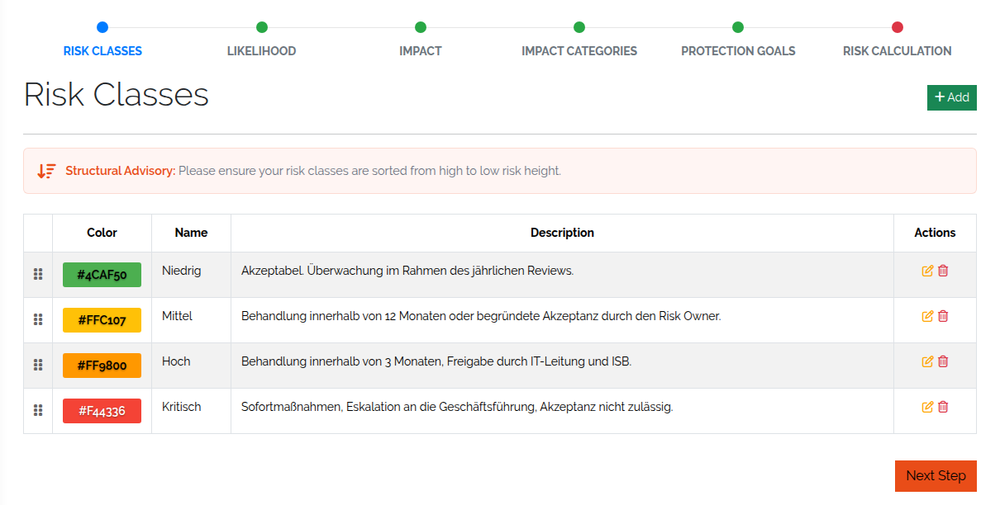
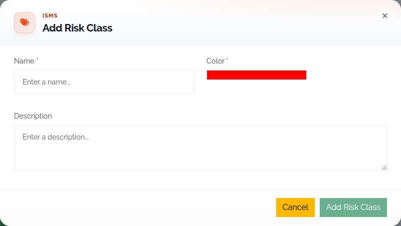
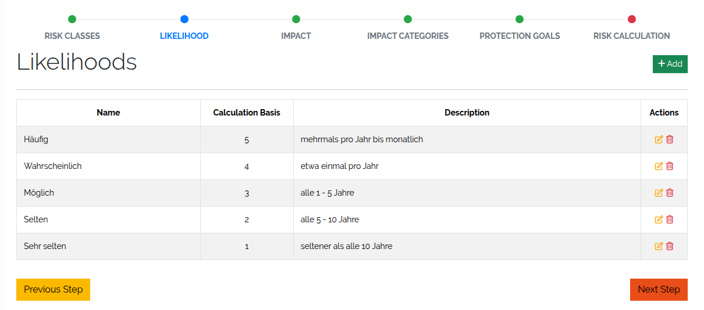
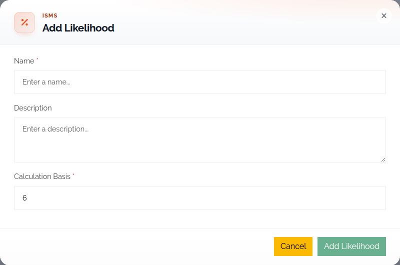
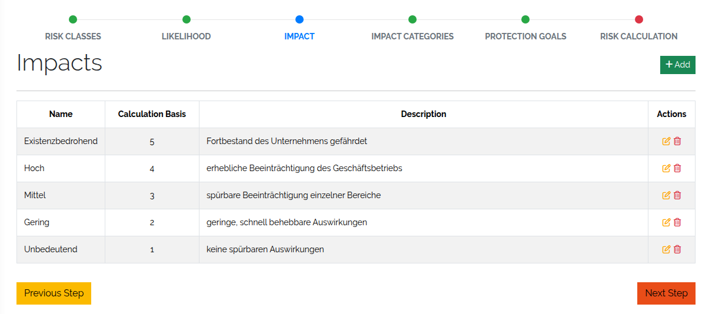
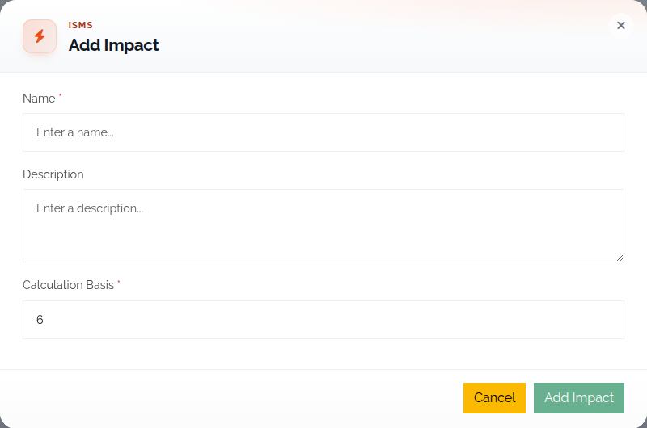
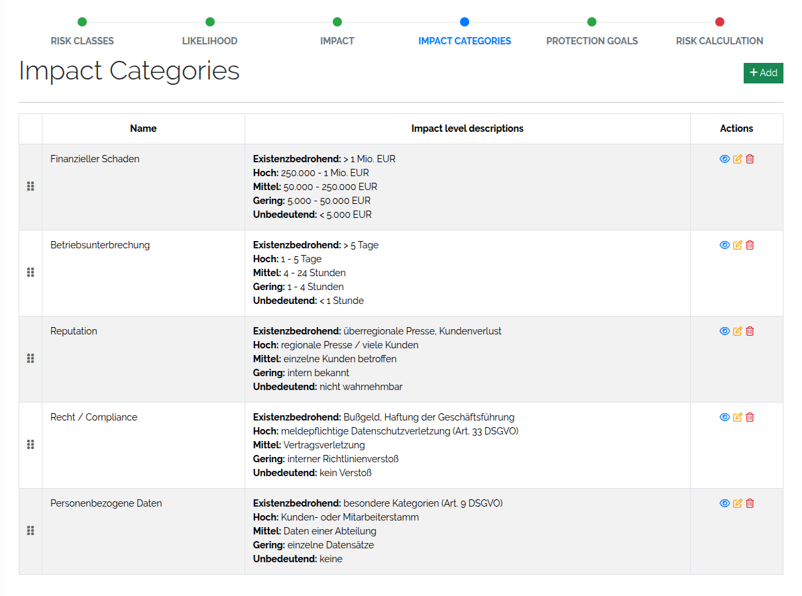
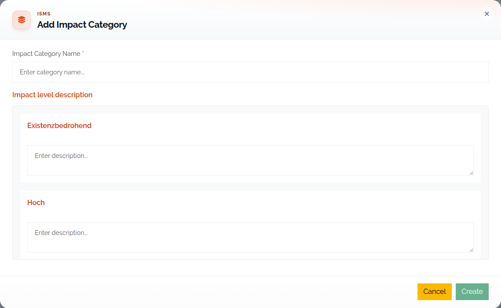
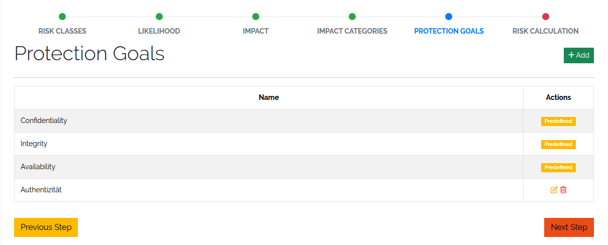
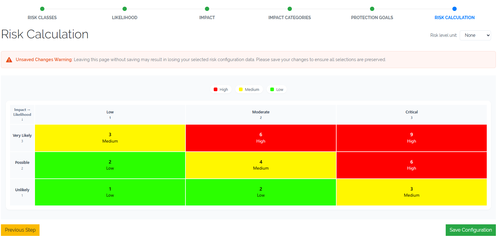

##################
Configure the ISMS
##################

|licensed| — on self-hosted installations this needs a license that includes ISMS; in the cloud it is
part of the subscription. See :doc:`../start/editions`.

.. contents::
   :local:

Before you can assess risks, you define the scales every assessment uses: risk classes, likelihoods,
impacts, impact categories, protection goals and the risk matrix. What these are and how they work
together is explained in :doc:`../concepts/isms`.

Open the configuration
======================

Go to **Toolbox → ISMS** and open **Configure ISMS Settings**. The configuration is a wizard with six
steps: **Risk Classes**, **Likelihood**, **Impact**, **Impact Categories**, **Protection Goals** and
**Risk Calculation**. Each step has an **Add** button and a table of the existing entries.

While the configuration is incomplete, the **Configure ISMS Settings** card on the ISMS overview is
flagged with *Some error in configuration. Please validate.* The configuration is complete when there
are

* at least three risk classes,
* at least three likelihoods,
* at least three impacts,
* at least one impact category, and
* a risk matrix with a risk class in every cell.

Work through the steps in order: the matrix can only be filled once risk classes, likelihoods and
impacts exist, and the **Impact Categories** step opens only when the impacts are complete.

.. _isms-risk-class-anchor:

Risk classes
============

Risk classes (or risk levels) group calculated risks into labelled levels such as *Low*, *Medium* or
*High*. The labels guide mitigation priorities, reporting and compliance evaluations.

   The risk classes step.

You need at least **three** risk classes; the **Add** button is disabled once there are ten. Sort them
from high to low risk — the step reminds you of this once three exist.

.. list-table::
   :header-rows: 1
   :widths: 25 75

   * - Field
     - Description
   * - **Name**
     - The name of the risk class, e.g. *Low*, *Moderate*, *Critical*.
   * - **Color**
     - The colour used for this class in the risk matrix, forms and reports.
   * - **Description**
     - A description of the risk class.

   Creating a risk class.

.. _isms-likelihood-anchor:

Likelihoods
===========

Likelihoods describe how probable it is that a risk scenario occurs. Together with impacts they are the
two dimensions of every risk evaluation.

   The likelihoods step.

You need at least **three** likelihood levels and can define at most **six**.

.. list-table::
   :header-rows: 1
   :widths: 25 75

   * - Field
     - Description
   * - **Name**
     - The name of the level, e.g. *Unlikely*, *Possible*, *Very Likely*.
   * - **Description**
     - A description of the level.
   * - **Calculation Basis**
     - A number that weights this level in the risk calculation. Each likelihood needs its own value;
       two likelihoods cannot share a calculation basis.

   Creating a likelihood.

A likelihood that is used in a risk assessment cannot be deleted.

.. _isms-impact-anchor:

Impacts
=======

Impacts describe how severe the consequences are if a risk occurs.

   The impacts step.

You need at least **three** impact levels and can define at most **six**.

.. list-table::
   :header-rows: 1
   :widths: 25 75

   * - Field
     - Description
   * - **Name**
     - The name of the level, e.g. *Low*, *Moderate*, *Critical*.
   * - **Description**
     - A short explanation of the consequence or damage at this level.
   * - **Calculation Basis**
     - A number that represents the severity in the risk calculation. Each impact needs its own value;
       two impacts cannot share a calculation basis.

   Creating an impact.

An impact that is referenced in a risk assessment cannot be deleted.

.. _isms-impact-categories-anchor:

Impact categories
=================

Impact categories are the areas in which you judge impact — for example financial damage, regulatory
consequences or business continuity. For each category you describe what every impact level means in
that area, so assessors pick consistent values. In a risk assessment, each category gets its own impact
slider.

   The impact categories step.

You need at least **one** impact category.

.. list-table::
   :header-rows: 1
   :widths: 25 75

   * - Field
     - Description
   * - **Impact Category Name**
     - The name of the category, e.g. *Financial*, *Legal*, *Operational*.
   * - **Impact Descriptions**
     - One description for each defined impact level, saying what that level means in this category.

   Creating an impact category.

Protection goals
================

Protection goals are the security objectives a risk can affect. Three are predefined:

* **Confidentiality** — information is accessible only to authorised parties.
* **Integrity** — information and systems are accurate and reliable.
* **Availability** — systems and data are accessible when needed.

Add your own for organisation-specific objectives, e.g. *Authenticity*, *Traceability* or
*Resilience*. A protection goal has a single field, its **name**, which must be unique. The predefined
goals cannot be edited or deleted.

   The protection goals step.

Risk matrix
===========

The **Risk Calculation** step holds the risk matrix. It maps every combination of likelihood and impact
to a risk class.

   The risk matrix.

The matrix is generated from your configuration: likelihoods form the rows (Y axis), impacts the columns
(X axis), so its size follows the number of likelihoods and impacts. The legend above it shows your risk
classes. For each cell, select the **risk class** that applies; the scores are calculated automatically.
Save your selection before you leave the step — unsaved matrix changes are lost.

**Risk level unit** sets a unit shown in the matrix cells: **None**, **Euro (€)** or **Dollar ($)**. It
is purely visual and does not affect the calculation or classification.

Rights
======

Each step has its own view, add, edit and delete rights, e.g. ``base.isms.riskClass.add`` or
``base.isms.riskMatrix.edit``. See :doc:`../reference/rights`.
