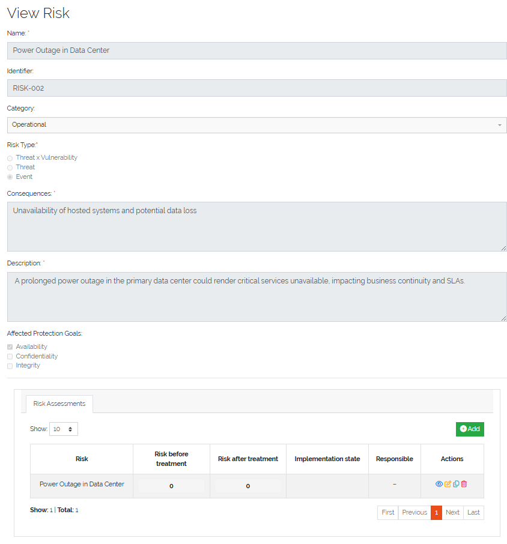
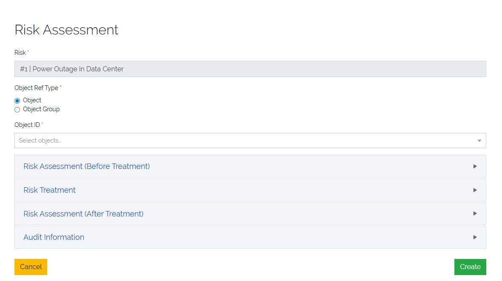
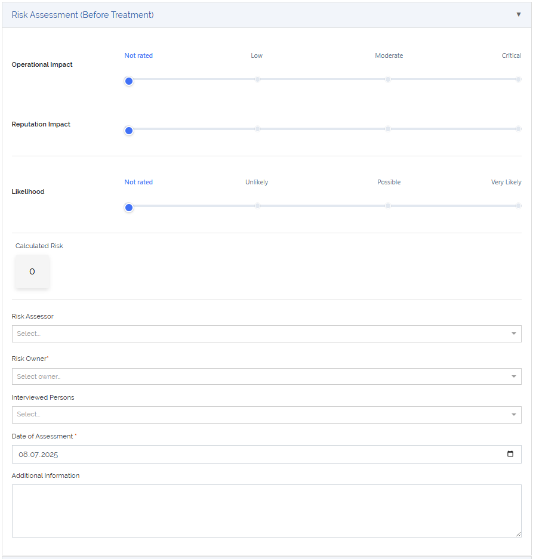
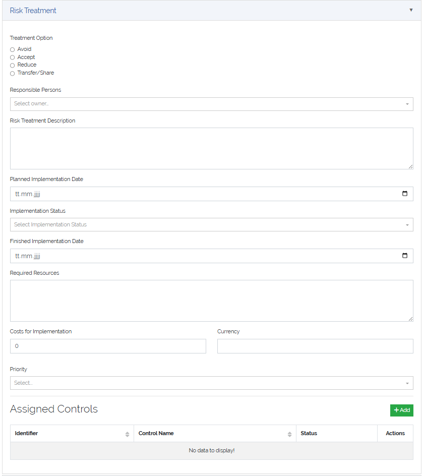
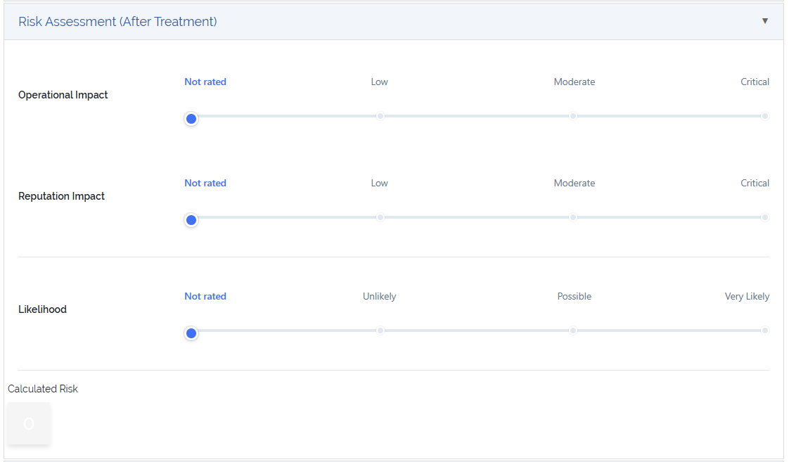
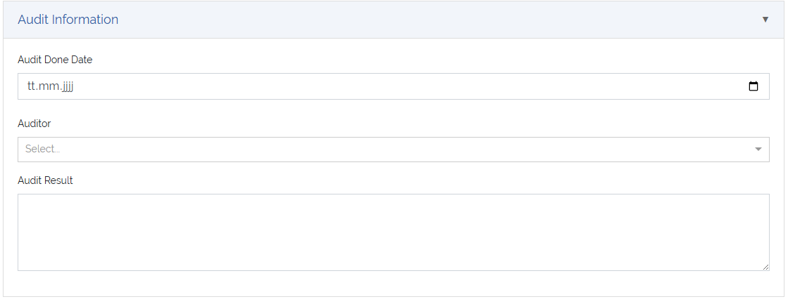
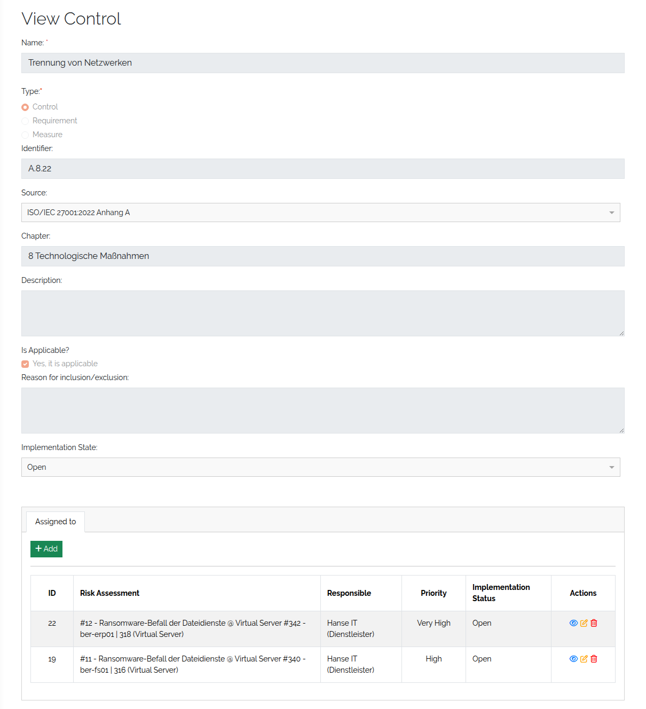

######################
Assess and treat risks
######################

|licensed| — on self-hosted installations this needs a license that includes ISMS; in the cloud it is
part of the subscription. See :doc:`../start/editions`.

.. contents::
   :local:

A risk assessment evaluates one risk for one object or object group, documents how the risk is treated,
re-evaluates it after treatment and records the audit. Control assignments link the controls that
implement the treatment. This page assumes a complete ISMS configuration (:doc:`isms-configure`) and the
risks and controls you need (:doc:`isms-catalogues`). The scoring is explained in
:doc:`../concepts/isms`.

Where risk assessments live
===========================

Risk assessments are **not** on the ISMS overview. You reach them from what they belong to:

* the detail view of an :ref:`object <objects-anchor>` — tab **Risk Assessments**,
* the detail view of an :ref:`object group <object-groups-anchor>` — tab **Risk Assessments**,
* the detail view of a risk — tab **Risk Assessments**.

   Risk assessments in the detail view of a risk.

Each list has **Add** to create an assessment and, per row, icons to view, edit, duplicate and delete it.

.. _isms-risk-assessments-anchor:

Create a risk assessment
========================

Click **Add** in one of the lists above. At the top of the form, select the **risk** and the
**object** or **object group** it is assessed for; the one you started from is already set.

   The top of the risk assessment form.

The rest of the form has four sections. Fill them in, then click **Create** (**Update** when editing).

Many fields are required, but some — such as costs or the audit details — are typically completed later
in the treatment lifecycle. *(3.3)* If required fields are missing, saving is blocked: the form shows
*Please fill in all required fields before saving.*, marks the missing fields and opens the first
section that contains one, even if it was collapsed.

Risk assessment (before treatment)
----------------------------------

The initial evaluation, before any mitigation.

.. list-table::
   :header-rows: 1
   :widths: 25 75

   * - Field
     - Description
   * - **Impacts**
     - One slider per impact category. Each slider selects one of the configured impact levels; each
       level has a numeric calculation basis.
   * - **Likelihood**
     - A single slider that selects the likelihood of the risk scenario. Each level has a numeric
       calculation basis.
   * - **Calculated Risk**
     - Calculated automatically as ``maximum impact (calculation basis) × likelihood (calculation
       basis)``, where the maximum impact is the highest impact selected across all impact categories.
       Shown in the colour of the resulting risk class.
   * - **Risk Assessor**
     - The :ref:`person <persons-anchor>` who performed the assessment, usually a member of the ISMS or
       risk management team.
   * - **Risk Owner**
     - The :ref:`person <persons-anchor>` or :ref:`person group <person-groups-anchor>` responsible for
       the risk.
   * - **Interviewed Persons**
     - The persons interviewed during the evaluation. Several entries are allowed.
   * - **Date of Assessment**
     - When the assessment was carried out.
   * - **Additional Information**
     - Free text for further context, observations or notes.

   Risk assessment before treatment.

Risk treatment
--------------

How the risk is addressed. Depending on the option you choose, provide responsibilities, timelines and
resources. Here you also assign controls (see `Assign controls`_).

.. list-table::
   :header-rows: 1
   :widths: 25 75

   * - Field
     - Description
   * - **Treatment Option**
     - *Avoid*, *Accept*, *Reduce* or *Transfer/Share* — see :doc:`../concepts/isms`.
   * - **Responsible Persons**
     - The :ref:`person <persons-anchor>` or :ref:`person group <person-groups-anchor>` that carries out
       the treatment.
   * - **Risk Treatment Description**
     - How the risk will be treated, which measures are applied and how they address it.
   * - **Planned Implementation Date**
     - The target date for completing the treatment.
   * - **Implementation State**
     - The current progress, e.g. *Open*, *In Progress*, *Implemented*.
   * - **Finished Implementation Date**
     - The date the treatment was fully implemented.
   * - **Required Resources**
     - Personnel, time, tools or other resources needed.
   * - **Cost for Implementation**
     - The estimated or actual cost, as a number.
   * - **Currency**
     - The currency of the cost, e.g. *EUR*, *USD*.
   * - **Priority**
     - *Low*, *Medium*, *High* or *Very High*.

   Risk treatment.

The implementation state matters for the reports: the *current state* risk matrix uses the risk after
treatment only for assessments whose state is *Implemented*.

Risk assessment (after treatment)
---------------------------------

The re-evaluation once the treatment is in place. It shows how effective the treatment and the controls
are and what residual risk remains.

.. list-table::
   :header-rows: 1
   :widths: 25 75

   * - Field
     - Description
   * - **Impacts**
     - One slider per impact category to re-evaluate the impact level.
   * - **Likelihood**
     - A single slider to re-evaluate the likelihood, on the same scale as before treatment.
   * - **Calculated Risk**
     - Recalculated automatically with the same formula. Compare it with the risk before treatment to
       show the effect of the treatment.

   Risk assessment after treatment.

Audit information
-----------------

Documents the verification of the treatment.

.. list-table::
   :header-rows: 1
   :widths: 25 75

   * - Field
     - Description
   * - **Audit Done Date**
     - The date the audit or review of the implemented treatment was completed.
   * - **Auditor**
     - The :ref:`person <persons-anchor>` or :ref:`person group <person-groups-anchor>` who performed
       the audit.
   * - **Audit Result**
     - Free text: outcome, observations, conclusions — e.g. whether the controls were effective,
       partially effective or need improvement.

   Audit information.

Duplicate a risk assessment
===========================

To reuse an assessment, click the duplicate icon in its row. The dialog depends on where you are:

* In the list of an **object** or **object group**, select one or more other **risks**; the assessment
  is copied for each of them, for the same object or group.
* In the list of a **risk**, select one or more other **objects** or **object groups** (the same kind
  as the original); the assessment is copied for each of them, for the same risk.

Check **Keep assigned Controls** to copy the control assignments as well, then click **Duplicate**.

Assign controls
===============

A control assignment links a control to a risk assessment and tracks its implementation. It shows which
controls are used where, who is responsible, and when they are due — which supports traceability,
prioritisation and audits.

There are two ways to assign a control:

* **In the risk assessment form** — in the **Risk Treatment** section, click **Add** next to the
  assigned controls, fill in the dialog and click **Add control**. The assigned controls are listed in a
  table below, where you can edit their implementation details.
* **From the control** — open a control's detail view, go to the **Assigned to** tab and click **Add**.
  Select the risk assessment to assign the control to. The tab also shows where the control is already
  used.

   Assigning a control from its detail view.

.. list-table::
   :header-rows: 1
   :widths: 30 70

   * - Field
     - Description
   * - **Control**
     - The control being assigned. Required.
   * - **Risk Assessment**
     - The risk assessment the control is linked to (set automatically in the risk assessment form).
   * - **Planned Implementation Date**
     - The date by which the control should be implemented.
   * - **Implementation Status**
     - The current status, e.g. *Planned*, *In Progress*, *Implemented*, chosen from an extendable list.
       Required.
   * - **Finished Implementation Date**
     - The date the implementation was completed.
   * - **Priority**
     - ``1`` *Low*, ``2`` *Medium*, ``3`` *High*, ``4`` *Very High*.
   * - **Responsible**
     - The person or person group responsible for implementing the control.

A control that is used in a control assignment cannot be deleted. Deleting a risk assessment, or the
risk it belongs to, removes its control assignments.

Rights
======

Risk assessments and control assignments have their own rights (``base.isms.riskAssessment.*``,
``base.isms.controlMeasureAssignment.*``). See :doc:`../reference/rights`.
