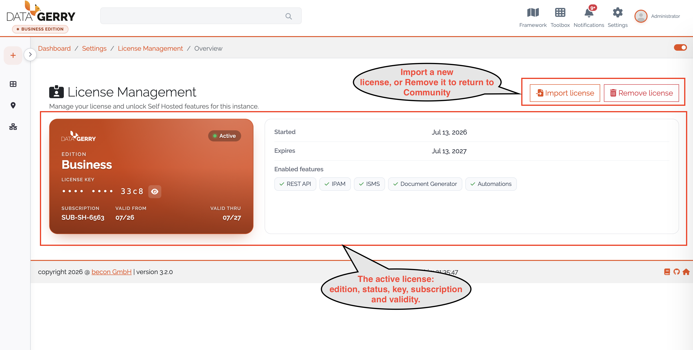

.. _license-management-anchor:

##################
License Management
##################

|selfhosted|

.. contents::
   :local:

A license turns a free Community installation into the Self-Hosted Edition and
unlocks premium features. This page shows how to activate, check and remove a
license. The editions are compared in :doc:`../start/editions`.

.. admonition:: Cloud and self-hosted
   :class: edition

   In the cloud, all premium features are part of the subscription. There is no
   license to manage: **Settings → License Management** is not shown, and the license
   routes of the REST API don't exist. On a self-hosted installation, you manage the
   license as described here.

Premium features
================

A license can unlock these features:

.. list-table::
   :header-rows: 1
   :widths: 30 70

   * - Feature
     - Covers
   * - **REST API**
     - Access to the REST API with HTTP Basic authentication
       (:doc:`../reference/rest-api`).
   * - **IPAM**
     - IP address management, and in 3.3 also racks, ports and cabling
       (:ref:`IPAM <ipam-anchor>`).
   * - **ISMS**
     - Information security management (:ref:`ISMS <isms-anchor>`).
   * - **Document Generator**
     - PDF documents from templates (:ref:`Document Generator <document-generator-anchor>`).
   * - **Automations**
     - Connectors and connections to other systems (:ref:`Automations <automations-anchor>`).

Which features a license unlocks is written in the license file itself. Licenses
come in tiers, shown in the interface as **Small**, **Medium** and **Large**
*(3.3)*; the tier is informational, the feature list in the license decides.

Everything else is part of the Community edition and always available. A feature
not covered by the active license stays locked and is marked with a **Pro** badge;
opening it shows an upgrade dialog that links to License Management.

Open License Management
=======================

Open **Settings → License Management** (``/settings/license``). You need these
rights (:doc:`../reference/rights`):

.. list-table::
   :header-rows: 1
   :widths: 40 60

   * - Right
     - Allows
   * - ``base.license.view``
     - Opening the page and seeing the license.
   * - ``base.license.activation.view``
     - Generating activation requests.
   * - ``base.license.edit``
     - Importing a license.
   * - ``base.license.delete``
     - Removing the license.

The page opens in one of two modes:

* On a **Community** or **Expired** installation, it opens the
  :ref:`activation wizard <license-activation-anchor>`.
* On an installation with an active license, it shows the
  :ref:`license overview <license-overview-anchor>`.

.. _license-activation-anchor:

Activate a license
==================

The activation wizard has four steps; the stepper on the left shows your progress.

#. **Generate request.** Click **Generate activation request**. DataGerry creates a
   request bound to this machine and shows it as a Base64 text block. **Copy** it or
   **Download** it as ``datagerry-activation-request.txt``, then click **Continue**.
   The request is valid for 60 minutes.

   .. figure:: ../img/license_management/license_generate_request.png
      :width: 800

      Generating the activation request.

#. **Service portal.** Open the Service Portal at
   `service.datagerry.com <https://service.datagerry.com>`_, go to its license
   management, upload or paste the activation request and download the license
   file. Then click **I have my license file**.

#. **Import license.** Drag the license file into the drop zone, or click it to
   browse, then click **Activate license**.

   .. figure:: ../img/license_management/license_import.png
      :width: 800

      Selecting the license file.

   .. figure:: ../img/license_management/license_import_2.png
      :width: 800

      The license file ready to activate.

#. **Complete.** The wizard confirms that the license is verified and the licensed
   features are active. Click **Finish**. The features are available at once,
   without reloading.

.. warning::

   Import the license file within 60 minutes of generating it in the portal.
   After that it expires and you have to start again with step 1.

.. _license-overview-anchor:

View the current license
========================

On a licensed installation the license overview shows:

* **Edition** and **Tier**
* **Status** (Active or Expired)
* **License key**, masked to the last four characters; the eye icon reveals it
* **Subscription ID**
* **Validity**, the valid-from and valid-thru dates (∞ for perpetual licenses)
* **Enabled features**, the premium features this license unlocks

   The license overview of a licensed installation.

If the stored license fails verification, a warning above the card says why (see
:ref:`license-states`).

The header of the overview offers:

* **Import license** — opens the activation wizard to import a new license file.
* **Remove license** — after confirmation, deletes the license and returns the
  installation to the Community edition.

.. warning::

   Removing the license immediately disables all premium features.

Explore premium features
========================

On an installation without an active license, the header offers **Explore
Self-Hosted features**. It opens a catalogue of the premium features by category;
tier filters show which features each tier includes. The catalogue is for
information only; what an installation actually has is decided by the active
license and enforced by the server. Click **Activate** to start the activation.

.. _license-states:

License states
==============

.. list-table::
   :header-rows: 1
   :widths: 25 75

   * - State
     - Meaning
   * - **Community**
     - No valid license. Only the core CMDB features are available.
   * - **Self-Hosted**
     - An active, verified license. The licensed premium features are unlocked.
   * - **Expired**
     - The license's validity has ended. Premium features are disabled until you
       renew and re-import the license.

If a stored license cannot be verified, the page shows one of these messages:

.. list-table::
   :header-rows: 1
   :widths: 35 65

   * - Message
     - What to do
   * - **License could not be verified**
     - The file is corrupted or malformed. Import a valid license file.
   * - **License not recognized on this machine**
     - The license doesn't match this machine. Generate a new activation request and
       have the license re-issued.
   * - **License not active yet**
     - The start date of the license lies in the future.
   * - **License expired**
     - The validity has ended. Renew and re-import the license.

A license that cannot be verified never locks you out; the installation falls back
to the Community edition.

.. note::

   Licenses are bound to the machine they were activated on. To move a license to
   another machine, generate a new activation request there and have the license
   re-issued.
