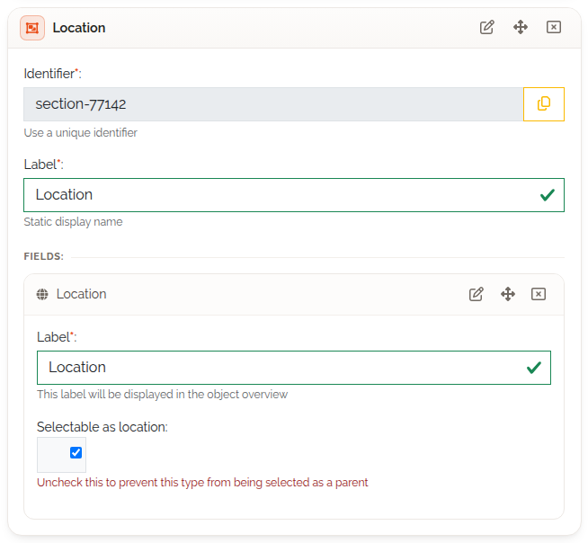
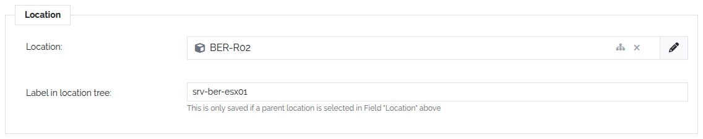
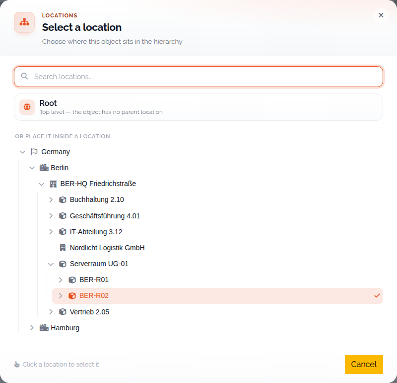
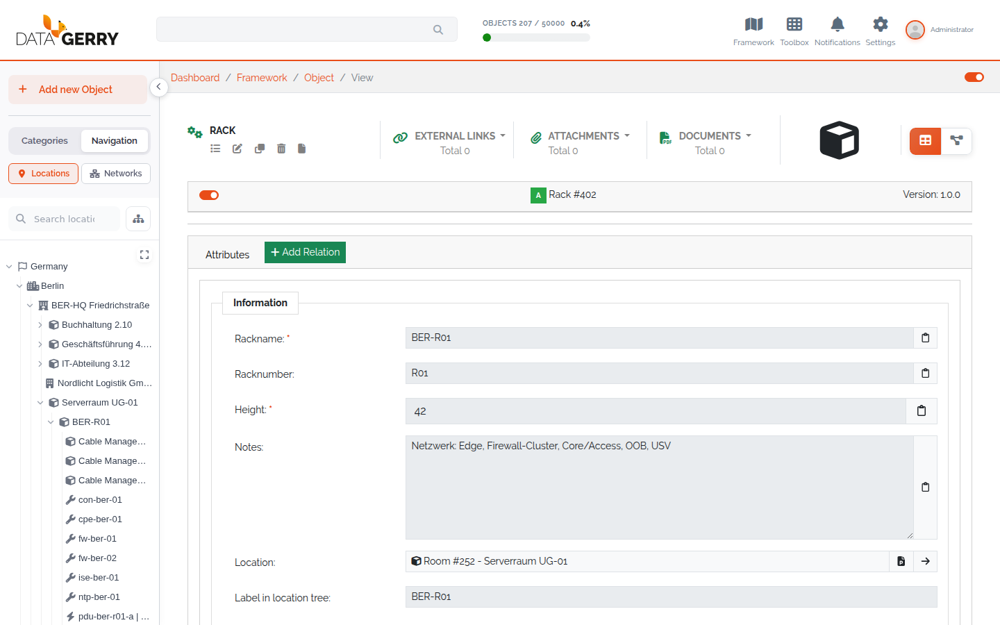

.. _locations-anchor:

#########
Locations
#########

.. contents::
   :local:

Locations arrange objects in a tree: a country or city at the top, then sites,
rooms, racks and the devices inside them. The tree is shown in the sidebar, so you
can find an object by where it is. This page assumes you know how types and objects
work (:doc:`../guides/model-types`, :doc:`../guides/work-with-objects`).

Enable locations for a type
===========================

An object only appears in the location tree if its type has the special control
**Location**.

#. Open **Framework → Types** and click the **Edit** icon of the type.
#. On the **Content** tab, drag **Location** from **Special Controls** into a
   section.
#. Set the two options of the control and save the type.

   The Location control in the type configuration.

.. list-table::
   :header-rows: 1
   :widths: 30 70

   * - Option
     - Meaning
   * - **Label**
     - Required. The name of the location field in the object view.
   * - **Selectable as location**
     - Whether objects of this type can be the parent of other objects. Clear it
       for types that never hold anything, for example a *Processor* that sits in
       a *Server* but never contains other objects.

A type can hold the Location control only once.

You cannot remove the Location field, or a section that contains it, while
objects of the type still have a location set. DataGerry shows **Cannot delete
location field** (or **Cannot delete section**) with a list of the affected
objects; remove the location from those objects first.

Place an object
===============

Open an object of the type in edit mode. The Location control adds two fields:

.. list-table::
   :header-rows: 1
   :widths: 30 70

   * - Field
     - Meaning
   * - *<Label>*
     - The parent location. Named after the **Label** you set on the type.
   * - **Label in location tree**
     - The name shown for this object in the tree. It is only saved when a parent
       location is selected in the field above.

   The two location fields on an object.

Click the location field to open the tree selector **Select a location**
*(3.3)*. It replaces the flat dropdown of earlier versions:

* **Root** at the top places the object at the top level ("the object has no
  parent location").
* Below it, expand the tree and click a location to select it. **Search
  locations...** finds a location by name.
* Locations whose type is not **Selectable as location** are greyed out ("This
  type cannot be selected as a parent location"). The object itself and its own
  sub-locations are not offered either.

   Choosing the parent location.

Save the object. It now appears in the location tree, and the location is stored
with the object in the same create, update or copy request *(3.3)*.

Use the location tree
=====================

In the sidebar, open **Navigation → Locations**. Click an entry to open that
object. When the sidebar is collapsed, hover the **Locations** icon to show the
tree as a flyout.

   The location tree in the sidebar.

From 3.3 the tree loads lazily: only the top level is fetched at first, and the
children of a node are loaded when you expand it. **Search locations...** above
the tree searches all locations, including ones not loaded yet, and opens the
tree down to every match.

Reorganise the tree
-------------------

*(3.3)* With the right ``base.framework.location.edit`` the tree shows an
**Organize locations** button next to the search box. It opens a dialog in which
you move locations to another parent:

* **Drag** a location onto its new parent, or onto **Root** ("Top level — drop
  here to remove the parent location").
* **Batch move**: tick several locations, then click **Move here** on the target.
* Click **Done** to close the dialog.

The dialog refuses a drop and says why:

* "A location can't be its own parent"
* "Can't move a location into one of its own sub-locations"
* "This location type can't contain other locations" — the target's type is not
  **Selectable as location**
* "Already in this location" / "Already at the top level"

Delete an object with sub-locations
===================================

An object whose location is the parent of other locations cannot be deleted on
its own; the edit form warns "Only deletable if this object is not a parent of a
location". Move the sub-locations to another parent first (see above) or remove
their location.

Objects placed in a rack are also listed in the location tree under the rack —
see :doc:`racks`.

Rights
======

*(3.3)* The location tree and its routes are gated by rights:

.. list-table::
   :header-rows: 1
   :widths: 40 60

   * - Right
     - Allows
   * - ``base.framework.location.view``
     - Seeing the **Locations** tab in the sidebar and reading the tree.
   * - ``base.framework.location.edit``
     - Re-parenting locations with **Organize locations**.

The full list of location rights is in :doc:`../reference/rights`.
