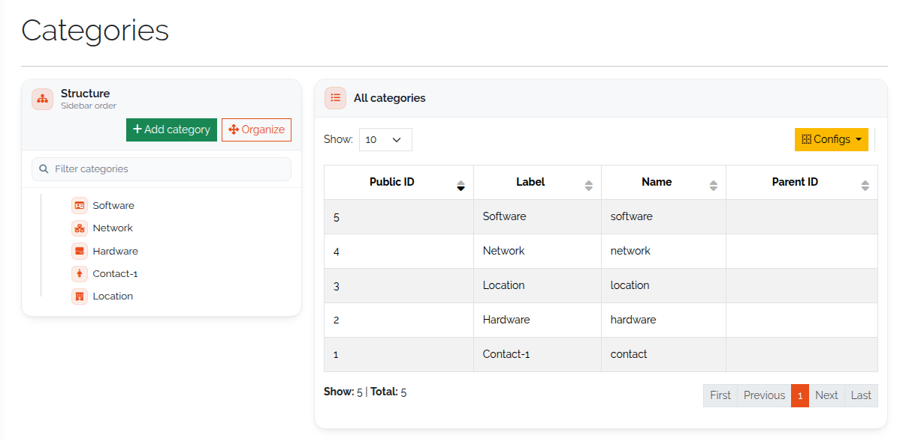
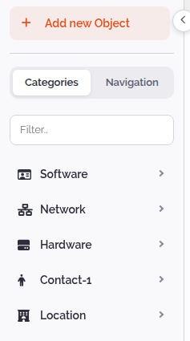
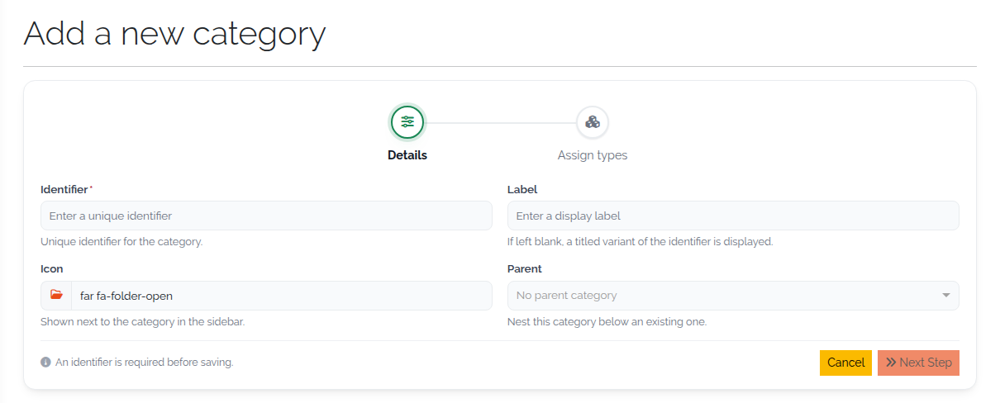
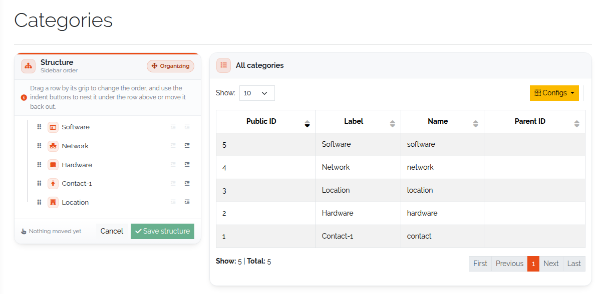
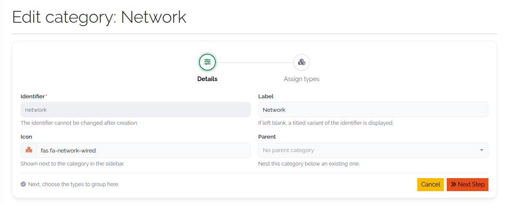
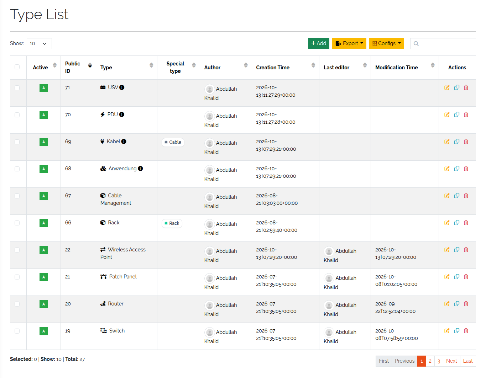
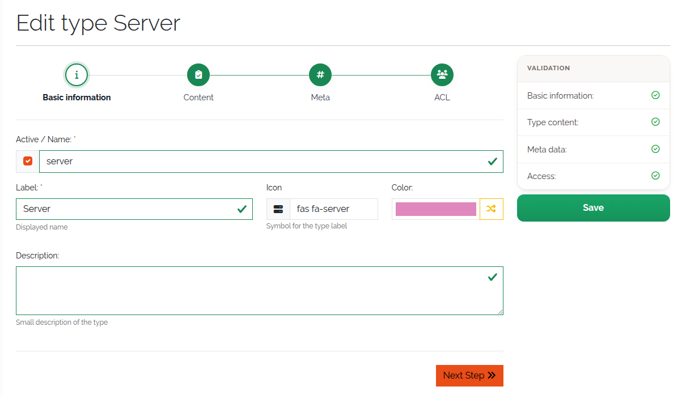
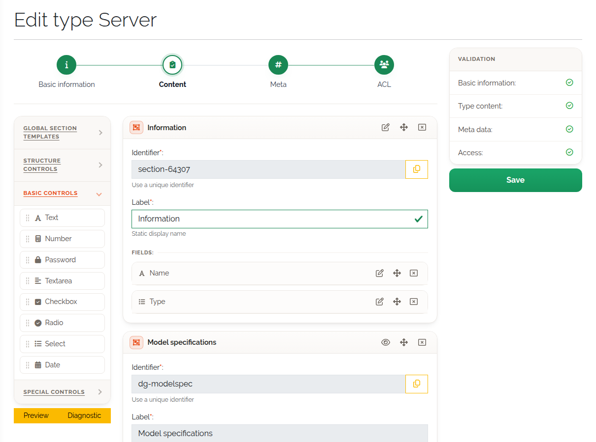
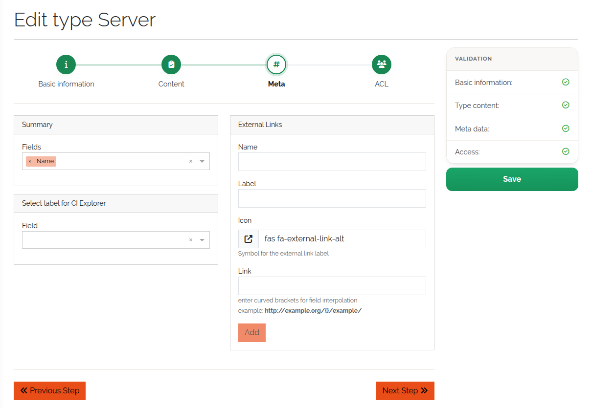
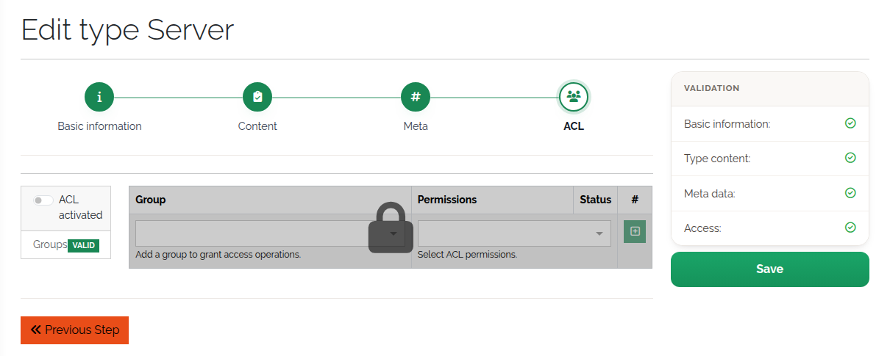

#############################
Build types and categories
#############################

.. contents::
   :local:

This page shows how to create and maintain categories and types. It assumes you know what they are
(:doc:`../concepts/data-model`). For the options of each field type, see
:doc:`../reference/field-types`.

.. _categories-anchor:

Categories
==========

Open **Framework → Categories**. The page has two panels:

* **Structure** — the category tree in sidebar order, with a filter box and **Expand all** /
  **Collapse all**.
* **All categories** — a table of every category with its public ID and parent.

   The categories page.

The same tree appears in the sidebar under **Categories**, with each category's types below it.
Types without a category are listed under **Uncategorized**.

   Categories in the sidebar.

Create a category
-----------------

#. Click **Add category**.
#. On the **Details** step fill in the fields below, then click **Next Step**.
#. On the **Assign types** step, move types from **Unassigned types** to **In this category** —
   drag them or use their **+** button. This step is optional; a type can belong to only one
   category, so only unassigned types are offered.
#. Click **Save category**.

.. list-table::
   :header-rows: 1
   :widths: 22 78

   * - Field
     - Meaning
   * - **Identifier**
     - Required, unique name of the category.
   * - **Label**
     - The name shown in the sidebar and the tables.
   * - **Icon**
     - Shown next to the label, for example in the sidebar.
   * - **Parent**
     - The category this one is nested under. Leave empty for a top-level category.

   Creating a category.

Rearrange categories
--------------------

#. Click **Organize**.
#. Drag a row by its grip to change the order. Use the indent buttons to nest a category under the
   row above, or to move it back out.
#. Click **Save structure**, or **Cancel** to discard the changes.

   Rearranging the category tree.

Edit or delete a category
-------------------------

Each row of the tree has an **Edit category** and a **Delete category** icon. The edit form has the
same two steps as the create form; on **Assign types** you can also change the order of the
assigned types.

   Editing a category.

To delete a category, type its name to confirm. Its types become unassigned; no type and no object
is deleted. The deletion cannot be undone.

.. _types-anchor:

Types
=====

Open **Framework → Types**. The type list shows every type with its active state, public ID, name,
special type, author, last editor and timestamps. **Add** creates a type; the **Export** button
exports the selected types (or all) as JSON.

   The type list.

Create a type
-------------

**Add** opens the type builder, a form of four steps. Steps 1 and 2 are required; once they are
valid you can save. The step indicator shows which steps still have errors *(3.3)*.

**Step 1 — Basic information**

.. list-table::
   :header-rows: 1
   :widths: 22 78

   * - Field
     - Meaning
   * - **Active / Name**
     - Required. The checkbox sets the type active; clear it to stop new objects of the type from
       being created. The name is the unique identifier — letters, numbers, ``-`` and ``_`` only.
   * - **Label**
     - Required. The name shown in the interface.
   * - **Icon**
     - Shown with the type in the sidebar and in lists.
   * - **Color**
     - The type's colour in the CI Explorer and on its special-type badge. The button next to it
       picks a random colour.
   * - **Special type**
     - Optional, only when creating the type: makes it a Supernet, Subnet, VLAN, Rack or Cable type.
       It cannot be changed afterwards; when you edit the type it is shown as a disabled field.
       Requires IPAM — see :doc:`../concepts/data-model`.
   * - **Description**
     - A short description, shown as a tooltip on the object list.

   Step 1 — Basic information.

**Step 2 — Content**

Build the type's sections and fields by dragging controls from the palette on the left into the
canvas. Click a field to edit its options.

.. list-table::
   :header-rows: 1
   :widths: 30 70

   * - Palette group
     - Contains
   * - **Global Section Templates**
     - Global and predefined section templates, including the virtual **Ports** template
       *(3.3)*. See :doc:`section-templates`.
   * - **Section Templates**
     - Your standard section templates.
   * - **Structure Controls**
     - **Section**, **Multi Data Section** and **Reference** (a reference section). Fields can
       only be placed inside one of these.
   * - **Basic Controls**
     - Text, Number, Password, Textarea, Checkbox, Radio, Select, Date.
   * - **Special Controls**
     - Reference and Location.

A type needs at least one section with one field. Since 3.3 a type whose only content is the
**Ports** section is valid too *(3.3)*.

If the type has a special type, its predefined sections and fields are already on the canvas. They
are locked: you can open their configuration but not change or remove it *(3.3)*.

   Step 2 — Content.

**Step 3 — Meta** (optional)

* **Summary** — the summary fields of the type: the default columns of the object list and what
  references to its objects display. Fields inside a multi data section cannot be summary fields.
* **Select label for CI Explorer** — the field whose value labels the type's objects in the
  :doc:`CI Explorer <ci-explorer>` graph.
* **External links** — quick links shown on the object page, for example to a device's web
  interface. Each link has a name, a label, an icon and a URL. Put ``{}`` in the URL where an
  object value belongs, and pick the fields to fill in under **Field of interpolation**, in order.
  Example: ``https://monitoring.example.org/host/{}/``.

   Step 3 — Meta.

**Step 4 — ACL** (optional)

Restricts which user groups may create, read, update and delete objects of this type. ACLs are off
by default (**ACL activated** cleared). See :ref:`acl-type-anchor`.

   Step 4 — ACL.

Click **Save** to create the type. It appears in the sidebar under its category, or under
**Uncategorized**.

Edit, copy or delete a type
---------------------------

The **Actions** column of the type list has three icons:

* **Edit type** opens the type builder with the current definition.
* **Copy type** opens the builder pre-filled with a copy, including summary fields and the CI
  Explorer label. Give it a new name and save.
* **Delete type** opens a summary page with the number of objects. Deleting is only possible when
  the type has no objects and is not used in any report.

What happens to existing objects
--------------------------------

When you save a changed type, DataGerry updates its objects right away *(3.3)*:

* a field you added is added to every object of the type, with its default value;
* a field you removed is removed from every object — **its stored values are lost**.

There is no separate step for this any more. Up to 3.2 the type list had a **Clean** column, and a
type whose fields had changed showed **Unclean** until you applied the change to its objects; that
column and the ``base.framework.type.clean`` right are gone.

.. warning::
   Removing a field or section from a type, or a field from a global section template, deletes the
   values of that field on all objects. Export the objects first if you might need the data.
