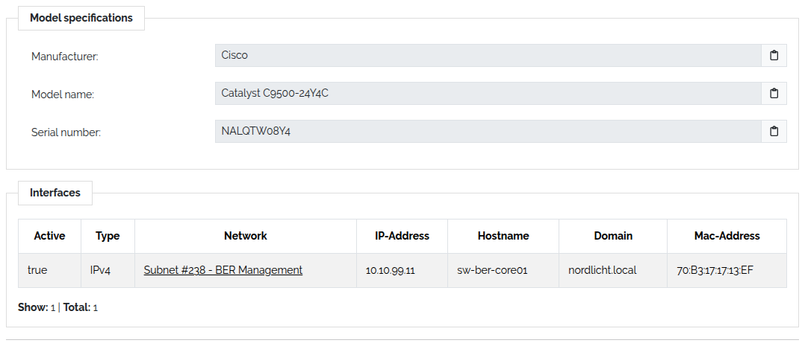
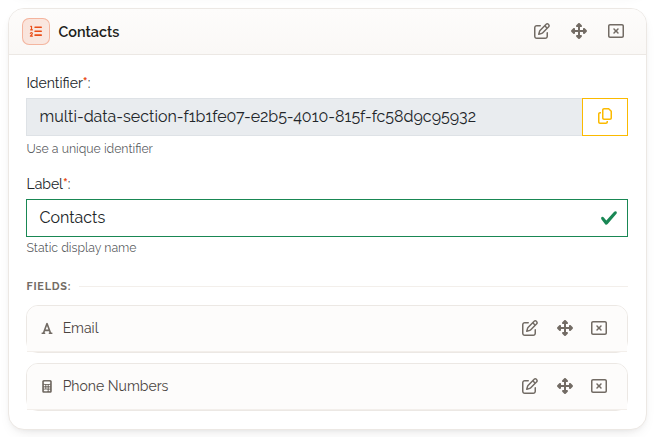
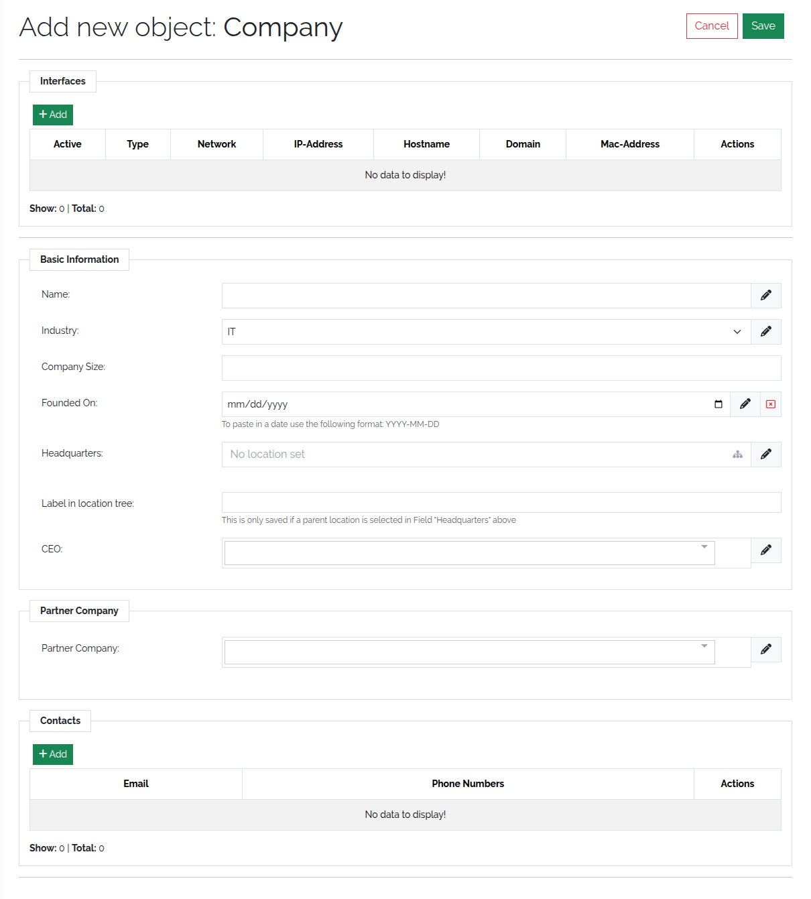
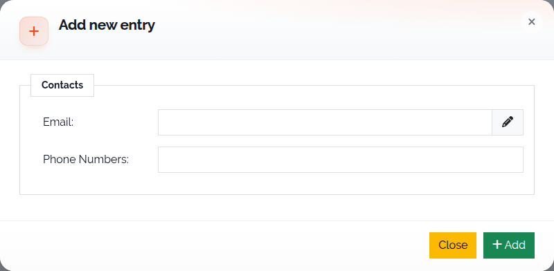
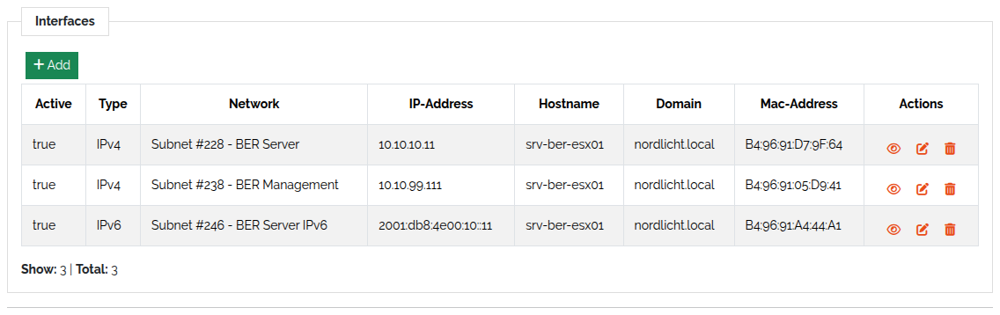

.. _mds-anchor:

###################
Multi data sections
###################

.. contents::
   :local:

A **multi data section** (MDS) is a section that stores a table of entries instead of one value
per field — the network interfaces of a server, the licences on a contract, the disks in a storage
array. This page shows how to add one to a type and fill it on an object. It assumes you know how
to build a type (:doc:`model-types`).

   A multi data section (a table of entries) next to a normal section.

Add a multi data section to a type
==================================

#. Open **Framework → Types** and edit a type, or create one.
#. On the **Content** step, drag **Multi Data Section** from **Structure Controls** onto the
   canvas. A type can have several.

   .. figure:: ../img/mds/mds_structure_control.png
      :width: 300

      The Multi Data Section control.

#. Drag fields from **Basic Controls** and **Special Controls** into it. Every control except
   **Location** works here.
#. For each field, decide whether it is a column of the table. Tick **Hide this field as column in
   object view/edit mode** to keep it out of the table; it still appears in the entry form.
#. Save the type.

   Fields in a multi data section.

A section template can also be a multi data section — see :doc:`section-templates`.

Fill it on an object
====================

When you create or edit an object, the MDS appears as a table whose columns are its visible fields,
plus **Actions**.

   An empty multi data section on a new object.

#. Click **Add** above the table.
#. Fill in the form — it shows all fields, including the hidden ones — and confirm with **Add**.
#. Repeat for further entries.
#. **Save the object.** Entries are only stored when the object is saved.

   Adding an entry.

The table pages after ten entries. Each entry has three actions:

* **Preview Row** — shows the entry's values;
* **Edit Row** — opens the entry in the form;
* **Delete Row** — deletes the entry after a confirmation.

   A multi data section with several entries.

Limitations
===========

* Fields inside an MDS cannot be summary fields of the type.
* A bulk change does not include multi data sections; edit them per object.
* In the :doc:`Document Generator <generate-documents>` each MDS field arrives as one value: the values of all entries joined
  by commas.
* Since 3.3, objects with an MDS can be exported as CSV, XLSX, XML and JSON, and imported from CSV
  and JSON *(3.3)*. Earlier versions supported JSON only. See :doc:`export-data` and
  :doc:`import-data`.
