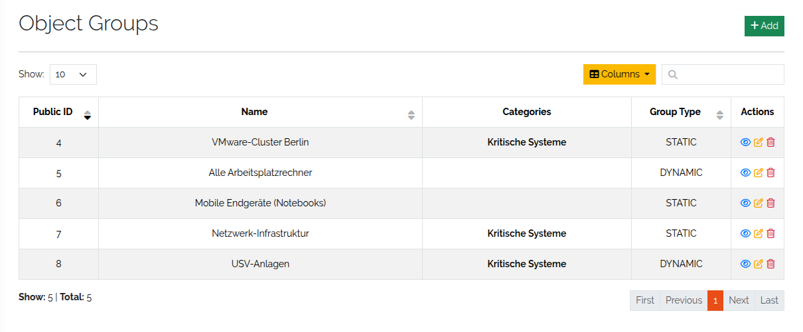
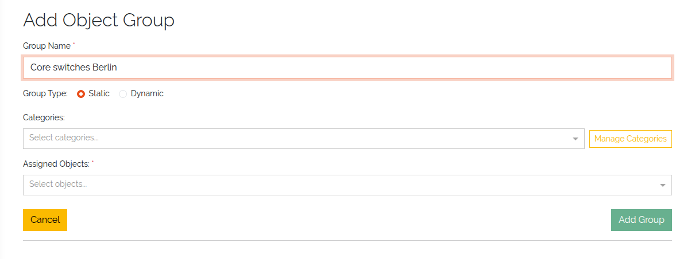
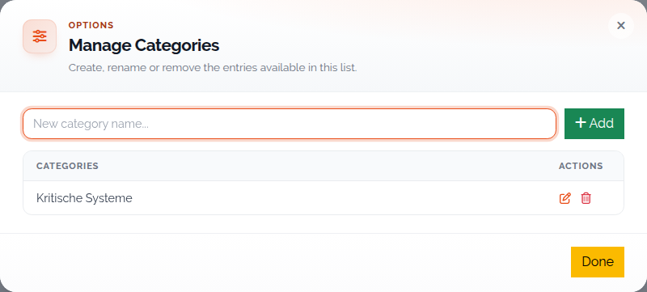
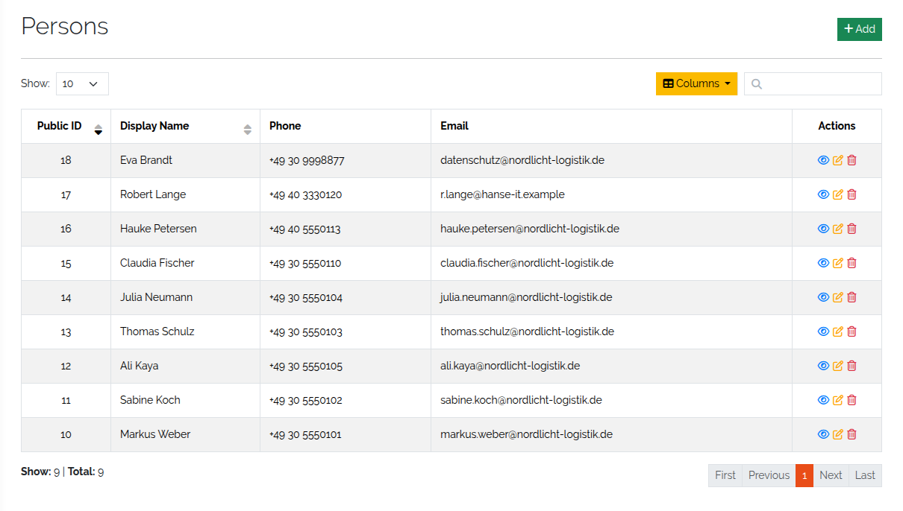
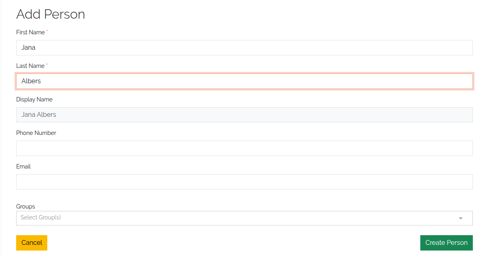
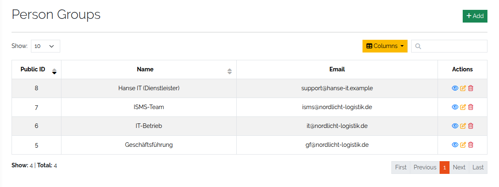
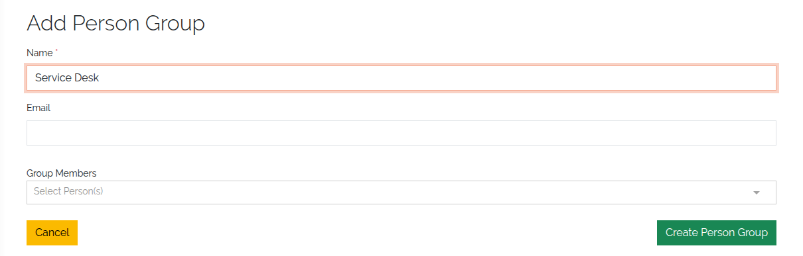

###################################
Object groups, persons and groups
###################################

|licensed| — on self-hosted installations these need a license that includes ISMS; in the cloud
they are part of the subscription. See :doc:`../start/editions`.

.. contents::
   :local:

Object groups, persons and person groups describe *who* and *what* outside the type system. They
are currently used by ISMS — risk assessments, responsibilities and reports refer to them (see
:doc:`../concepts/isms`). Other parts of DataGerry do not use them yet.

All three live in the **Framework** menu. Without the ISMS feature the menu entries carry a **Pro**
badge.

.. _object-groups-anchor:

Object groups
=============

An object group collects configuration items that belong together — the servers, load balancers
and databases of one service — so that you can treat them as one unit, for example in a risk
assessment. There are two kinds:

* **Static** — you pick the objects one by one. Full manual control.
* **Dynamic** — you pick types; every object of those types belongs to the group, including
  objects created later. Good for environments that change often.

Open **Framework → Object Groups**. The table lists all groups; the icons in each row view, edit
or delete a group. The footer of a group shows its **Risk Assessments**.

   The list of object groups.

Create an object group
----------------------

Click **Add** and fill in the form:

.. list-table::
   :header-rows: 1
   :widths: 26 74

   * - Field
     - Meaning
   * - **Group Name**
     - The name of the group.
   * - **Group Type**
     - **Static** or **Dynamic**.
   * - **Categories**
     - Tags to organise and filter groups — by business area, service level, environment and so
       on. Several are allowed.
   * - **Assigned Objects** / **Assigned Types**
     - The objects of a static group, or the types of a dynamic group.

   Creating an object group.

**Manage Categories** next to the categories field maintains the list of tags. The tags are shared
by all object groups. They are unrelated to the type categories of the sidebar.

   Managing object group categories.

.. _persons-anchor:

Persons
=======

A person is a real individual relevant to your organisation — an employee, an external contact, a
role holder — that ISMS records can name as responsible. A person is **not** a DataGerry user and
cannot log in. For user accounts see :ref:`users-anchor`.

Open **Framework → Persons** to list, add, edit and delete persons.

   The list of persons.

Click **Add**, fill in the form and click **Create Person**:

.. list-table::
   :header-rows: 1
   :widths: 26 74

   * - Field
     - Meaning
   * - **First Name**
     - Required.
   * - **Last Name**
     - Required.
   * - **Display Name**
     - Read-only. Built as *First Name Last Name*; this is how the person appears elsewhere.
   * - **Phone Number**
     - Optional.
   * - **Email**
     - Optional. Must be a valid address.
   * - **Groups**
     - The person groups the person belongs to. The groups' member lists are updated to match.

   Creating a person.

.. _person-groups-anchor:

Person groups
=============

A person group bundles persons — a department, a team, the holders of a role — so ISMS records can
name a group instead of individuals.

Open **Framework → Person Groups** to list, add, edit and delete groups.

   The list of person groups.

Click **Add** and fill in the form:

.. list-table::
   :header-rows: 1
   :widths: 26 74

   * - Field
     - Meaning
   * - **Name**
     - The name of the group.
   * - **Email**
     - Optional. A shared address for the group.
   * - **Group Members**
     - The persons in the group. Each person's **Groups** field is updated to match.

   Creating a person group.

Membership is one relationship seen from two sides: whether you add a person to a group in the
person form or in the group form, both stay in sync.
