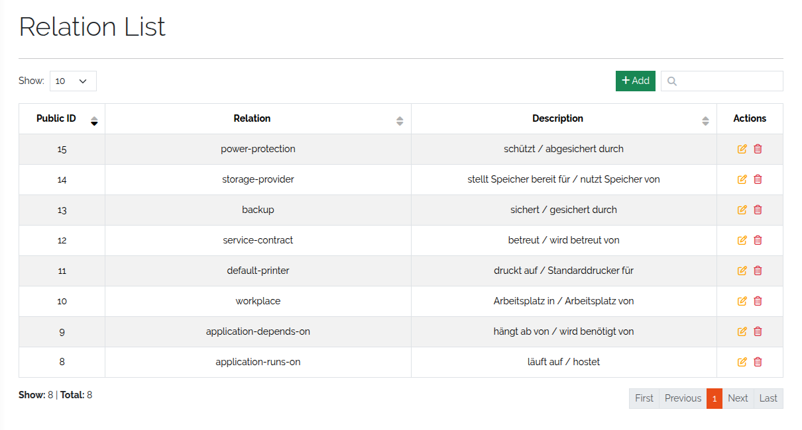
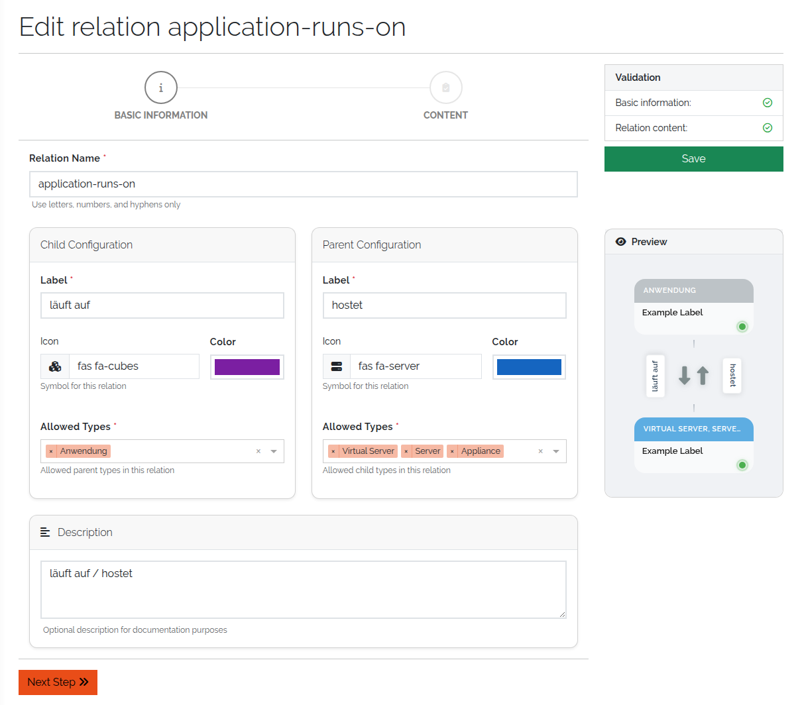
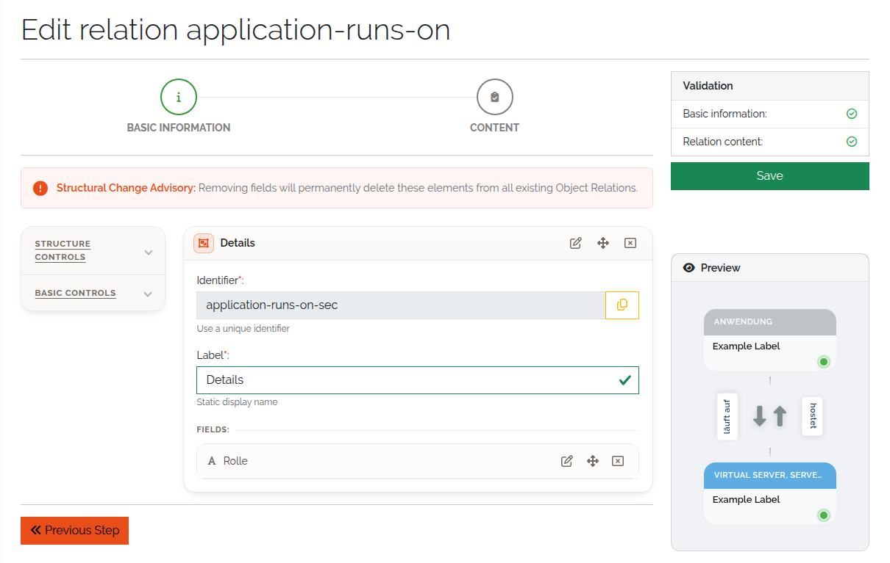
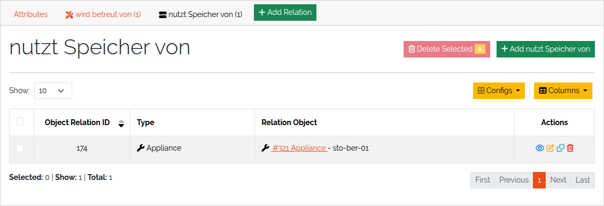

.. _n-m-relations-anchor:
.. _nm-relations-anchor:

#############
N:M relations
#############

.. contents::
   :local:

An **N:M relation** links objects many-to-many, in both directions, and can carry fields of its
own: *Application runs on Server*, with a deployment date; *Person works on Project*, with a role.
When to prefer it over a reference field is explained in :doc:`../concepts/relationships`.

You work with relations in two stages: first define a **relation type** — the schema — under
**Framework → Relations**, then link individual objects with it from the object view.

Define a relation type
======================

Open **Framework → Relations** and click **Add**.

   The list of relation types.

The form has two steps, **Basic information** and **Content**.

Basic information
-----------------

.. list-table::
   :header-rows: 1
   :widths: 28 72

   * - Field
     - Meaning
   * - **Relation Name**
     - Required, unique. Letters, numbers and hyphens only, for example ``Server-Connection``.
   * - **Label** (parent side)
     - Required. How the relation reads from the parent, for example *Contains* or *hosts*.
   * - **Icon** and **Color** (parent side)
     - How the relation is shown on the parent object.
   * - **Allowed Types** (parent side)
     - Required. The types whose objects can be the parent.
   * - **Label** (child side)
     - Required. How the relation reads from the child, for example *Part Of* or *runs on*.
   * - **Icon** and **Color** (child side)
     - How the relation is shown on the child object.
   * - **Allowed Types** (child side)
     - Required. The types whose objects can be the child.
   * - **Description**
     - Optional. What the relation is for.

A type may be allowed on both sides at once — for example *Server* as parent and child of a
*replicates to* relation.

   Basic information of a relation type.

Content
-------

Optional. Build sections and fields that every link of this type carries — status, purpose, notes,
dates. The builder is the same as for types *(3.3)*, with plain **Section** as the only structure
control and the **Basic Controls**; section templates and special controls are not available here.

   Fields of a relation type.

Save the relation type. Edit and delete it from the **Actions** column of the list.

Link two objects
================

#. Open an object whose type is allowed in a relation type.
#. Click **Add Relation**.

   .. figure:: ../img/nm_relations/nm_relations_add_object_relation.png
      :width: 700

      Add Relation in the object view.

#. Pick the relation from the table. It lists every relation type that applies to this object's
   type:

   * if the type is an allowed **parent**, the relation appears in its parent → child direction;
   * if it is an allowed **child**, it appears in its child → parent direction;
   * if it is allowed on both sides, you get two entries, one per direction.

   .. figure:: ../img/nm_relations/nm_relations_select_object_relation.png
      :width: 700

      Relations available for the current object.

#. Fill in the relation's fields, if it has any, and select the object on the other side.
#. Click **Save**.

   .. figure:: ../img/nm_relations/nm_relations_object_relation_select_child.png
      :width: 700

      Relation fields and the related object.

See and change links
====================

Each relation appears in the object view, next to **Add Relation**, as a tab named after the
relation's label in that direction. The tab lists all links of that relation in a table; relation
fields can be shown as columns *(3.3)*. Every row has **View Relation**, **Edit Relation**, **Copy
Relation** and **Delete Relation**.

   The links of one relation on an object.

The tab's own **Add** button skips the relation choice and opens the form for that relation
directly.

A link always shows up on both objects, each in its own direction: link an application to a server
with *runs on*, and the server lists the application under *hosts*.
