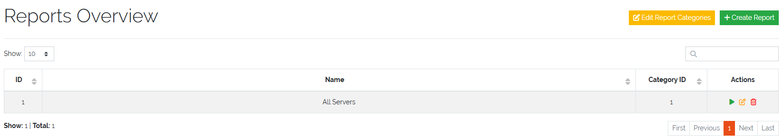
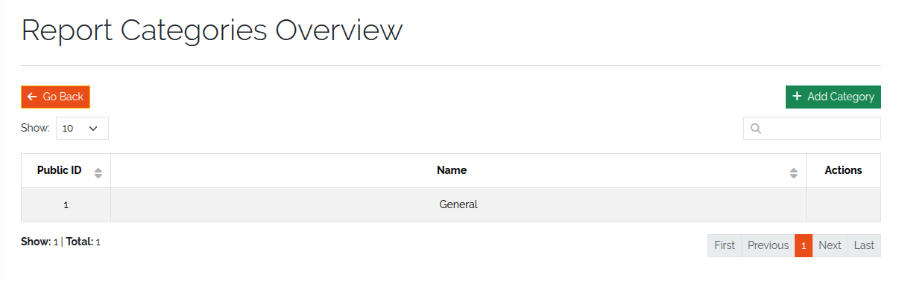
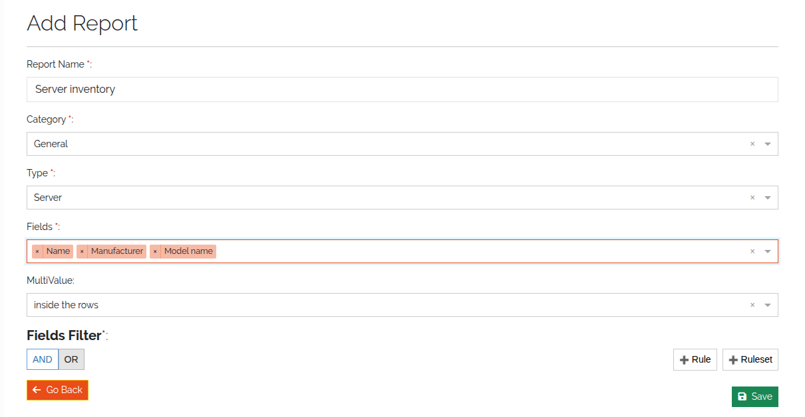

.. _reports-anchor:

#######
Reports
#######

.. contents::
   :local:

A report is a saved query over the objects of one type: which fields to show and which
objects to include. You run it on demand and download the result as CSV. Reports are
under **Toolbox → Reporting**.

Access is controlled by the report rights *(3.3)*: ``base.framework.report.view`` shows the
menu entry and the list; ``add``, ``edit`` and ``delete`` gate the matching actions. See
:doc:`../reference/rights`.

The report list
===============

**Reports Overview** lists all reports with ID, name and category. Per report you can
**Run Report** (play icon), **Edit Report** or **Delete Report**. A report whose fields
are missing (for example after they were removed from the type) can't be run until you
edit it.

Above the table:

* **Edit Report Categories** — create, edit and delete report categories. Every report
  belongs to one category.
* **Add** — create a report.

   The report list.

   Report categories.

Create a report
===============

Click **Add** and fill in:

.. list-table::
   :header-rows: 1
   :widths: 25 75

   * - Field
     - Meaning
   * - **Report Name**
     - A descriptive name, at least three characters.
   * - **Category**
     - The report category.
   * - **Type**
     - The :doc:`type <model-types>` the report is based on, for example *Server*.
   * - **Fields**
     - The fields of that type that appear as columns.
   * - **MultiValue**
     - How multi-value fields are output: **inside the rows** or **inside the columns**.
   * - **Fields Filter**
     - Optional conditions that limit the objects, combined with nested AND / OR groups.

Click **Save**. The report appears in the list.

   Creating a report.

Run and export a report
=======================

Click the play icon of a report. **Report Results** shows the matching objects with the
selected fields. **Export as CSV** downloads the result.

Reports can also be embedded into PDF documents — see :doc:`generate-documents`.
