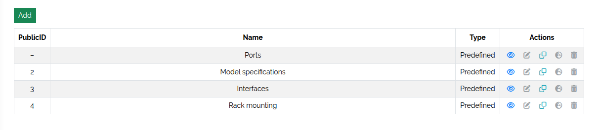
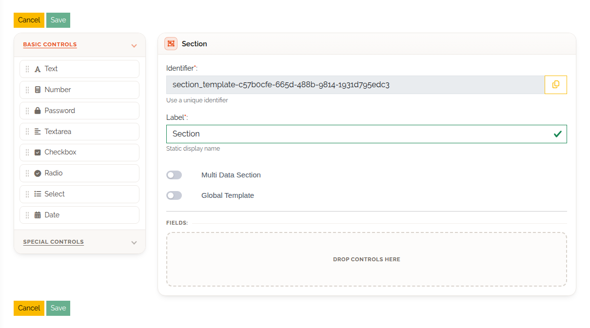
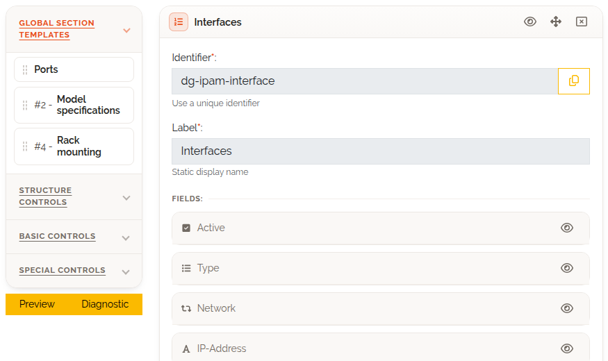
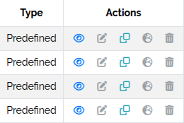

.. _section-templates-anchor:

#################
Section templates
#################

.. contents::
   :local:

A section template is a section you build once and reuse in many types — an *Address* block, a
*Warranty* block, a *Contact* block. This page shows how to create, use and maintain them. It
assumes you know how to build a type (:doc:`model-types`).

Kinds of templates
==================

The **Type** column of the template list shows one of three kinds:

.. list-table::
   :header-rows: 1
   :widths: 16 28 28 28

   * -
     - Standard
     - Global
     - Predefined
   * - **Who creates it**
     - You
     - You
     - DataGerry
   * - **In a type, it becomes**
     - An ordinary copy, editable in the type
     - A linked section, not editable in the type
     - A linked section, not editable in the type
   * - **Times per type**
     - As often as you like
     - Once
     - Once
   * - **Changing the template**
     - Does not affect types that already used it
     - Changes every type and object that uses it
     - Not possible
   * - **Deleting the template**
     - Does not affect types
     - Removes the section and its values from every type and object
     - Not possible
   * - **Can be cloned**
     - Yes
     - Yes
     - Yes

**Standard** templates are a shortcut: once dropped into a type, the section belongs to the type
and has no connection to the template any more. You can add and remove fields there.

**Global** templates stay connected. Every type records which global templates it uses, and a
change to the template reaches all of them:

* add a field to the template — every type and object using it gets the field;
* remove a field — it disappears from every type and object, **with its stored values**;
* delete the template — its section and data are removed from every type and object.

**Predefined** templates are global templates delivered with DataGerry. You cannot edit or delete
them, but you can clone them; the clone is an ordinary standard or global template.

Virtual templates
-----------------

Some predefined templates are **virtual** *(3.3)*. A virtual template looks like a global template
in the palette and in the template list (without a public ID), but its data is not stored on the
object. Dropping it into a type switches on a feature for that type instead.

The one virtual template so far is **Ports**: it gives the type's objects network ports. See
:doc:`ports-and-cabling`. Virtual templates can be cloned *(3.3)*; the clone is a normal template
with ordinary fields and no longer switches the feature on.

Open the template list
======================

Open **Framework → Section Templates**. The list shows each template's public ID, name and kind.

   The section template list.

Create a template
=================

#. Click **Add**.
#. Drag fields from **Basic Controls** and **Special Controls** into the section, and set their
   options as in a type. The **Location** control is not available: a type can have it only once,
   so it is set in the type itself.
#. Give the section a label.
#. Decide on the two switches — both can only be set now, not changed later:

   * **Multi Data Section** — the template is a multi data section rather than a plain section
     (see :doc:`multi-data-sections`).
   * **Global Template** — the template is global. Left off, it is a standard template.

#. Click **Save**. Saving is possible once the section has at least one field.

   Creating a section template.

Use a template in a type
========================

In the **Content** step of the type builder, the palette has two template groups:

* **Global Section Templates** — global, predefined and virtual templates;
* **Section Templates** — standard templates.

Drag a template onto the canvas like a new section.

   Section templates in the type builder.

Maintain templates
==================

The **Actions** column offers, depending on the kind:

   Template actions.

.. list-table::
   :header-rows: 1
   :widths: 26 74

   * - Action
     - What it does
   * - **View Template**
     - Shows a preview of the section and its fields.
   * - **Edit**
     - Opens the template in the editor. Not available for predefined templates. Saving a
       global template changes all types and objects that use it; this cannot be undone.
   * - **Clone Section Template**
     - Creates a copy. Enter a **Template name** and tick **Global Template** if the copy should be
       global. Works for every kind, including predefined and virtual templates.
   * - **Transform to Global Template**
     - Standard templates only. Turns the template into a global one. Types that used it before
       are not linked to it — the transformed template starts with no users. Cannot be undone.
   * - **Global Template** (globe icon)
     - Not an action: marks a template that is already global (this includes predefined ones).
   * - **Delete**
     - Deletes the template. For a global template the confirmation shows how many types and
       objects use it; their section and its values are removed with it. Not available for
       predefined templates.

Rights
======

All rights are listed in :doc:`../reference/rights`.

.. list-table::
   :header-rows: 1
   :widths: 42 58

   * - Right
     - Allows
   * - ``base.framework.sectionTemplate.view``
     - Opening **Framework → Section Templates** and the preview.
   * - ``base.framework.sectionTemplate.add``
     - Creating templates. Together with ``edit``: cloning and transforming.
   * - ``base.framework.sectionTemplate.edit``
     - Editing templates. Together with ``add``: cloning and transforming.
   * - ``base.framework.sectionTemplate.delete``
     - Deleting templates (predefined ones never).
   * - ``base.framework.sectionTemplate.*``
     - All of the above.
