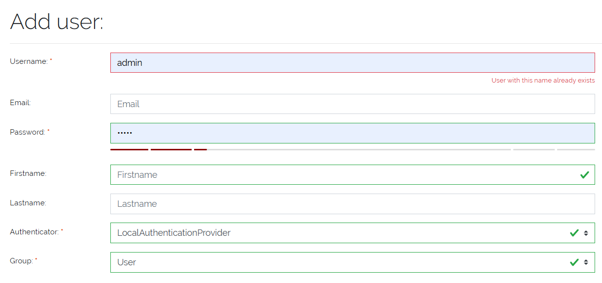
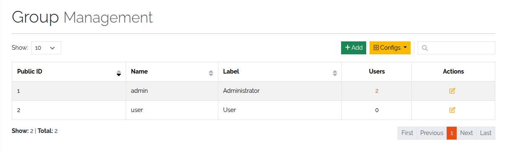
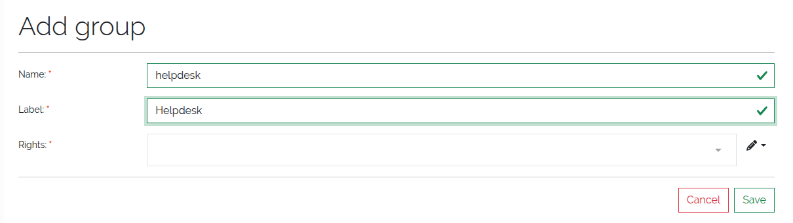

################
Users and groups
################

.. contents::
   :local:

This page shows how to create users and user groups and how to give a group its
rights. It assumes you know how users, groups and rights relate
(:doc:`../concepts/permissions`). All rights are listed in :doc:`../reference/rights`.

User management is under the **Settings** menu (gear icon), section
**User Management**: **Groups**, **ACL**, **Users** and **Rights**.

.. _users-anchor:

Users
=====

.. admonition:: Cloud and self-hosted
   :class: edition

   In the cloud, users come from the Service Portal: you invite and remove them
   there, and they appear in DataGerry after their first login. The **Users** list
   shows them, but there is no **Add** button, no password change, and the user form
   is read-only. See :doc:`../cloud/users`. The rest of this section applies to
   self-hosted installations.

**Settings → Users** lists all users with their basic details and group. Each row
has actions to edit the user, change the password and delete the user.

Create a user
-------------

#. Open **Settings → Users** and click **Add**.
#. Fill in the form and click **Save**.

   The form for a new user.

.. list-table::
   :header-rows: 1
   :widths: 25 75

   * - Field
     - Meaning
   * - **Username**
     - Required. The unique name the user logs in with.
   * - **Email**
     - Optional contact address.
   * - **Password**
     - Required for local users. It must pass the strength check shown below the
       field.
   * - **Firstname**, **Lastname**
     - Optional. Used to display the user.
   * - **Authenticator**
     - Required. How the user logs in: ``LocalAuthenticationProvider`` (user name and
       password stored in DataGerry) or ``LdapAuthenticationProvider`` (password
       checked against an LDAP directory, self-hosted only). See
       :doc:`authentication`.
   * - **Group**
     - Required. The user group whose rights the user gets. New users default to
       **User**.

Users authenticated by LDAP usually don't need to be created by hand: the LDAP
provider creates them at their first login (:doc:`authentication`).

Edit a user
-----------

Click the edit icon in the user list. Below the form, the edit page also lists the
object ACLs of the user's group (see :doc:`access-control`), if you hold
``base.framework.type.edit``.

To change a password, use the key icon in the user list or **Change Password?** on
the user's own page. Passwords of LDAP users are managed in the directory and cannot
be changed in DataGerry.

Users without ``base.user-management.user.edit`` can still change their own first
name, last name, email and picture, but not their user name, group or authenticator.

User restrictions
-----------------

* The initial **admin** user (public ID 1) cannot be deleted. Its delete icon is
  hidden.
* A user belongs to exactly one group.

.. _user-groups-anchor:

User groups
===========

**Settings → Groups** lists all groups. From the list you can see a group's users,
edit it and delete it.

   The list of user groups.

The two predefined groups, **Administrator** and **User**, cannot be deleted. The
**Administrator** group always keeps the master right ``base.*``; saving it without
that right is refused *(3.3)*.

Create a group
--------------

#. Open **Settings → Groups** and click **Add**.
#. Enter the fields below and select the group's rights.
#. Click **Save**.

.. list-table::
   :header-rows: 1
   :widths: 25 75

   * - Field
     - Meaning
   * - **Name**
     - Required. The internal identifier of the group.
   * - **Label**
     - The display name shown in lists and selections.
   * - **Rights**
     - The system rights the members get. See :ref:`group-rights`.

   The form for a new user group.

Delete a group
--------------

When you delete a group that still has members, choose what happens to them:

* **Move users to group** — the members move to the group you select.
* **Delete all users in this group** — the members are deleted. Not possible if the
  initial **admin** user is a member.

The delete is refused while the group is still needed elsewhere:

* it is the only group an active type ACL grants access to (the type and its objects
  would become unreachable for everyone), or
* it is the default group or part of a group mapping of the LDAP provider.

If the group appears in a type ACL next to other groups, only its ACL entry is
removed.

.. _group-rights:

Choose the rights of a group
============================

Rights are named hierarchically. Granting a right that ends in ``.*`` grants every
right below it:

::

   base.*                          all rights
   base.framework.*                the whole framework
   base.framework.object.*         everything about objects
   base.framework.object.view      viewing objects only
   base.framework.object.add       adding objects only

**Settings → Rights** lists every right with its description, its level and the
groups that hold it. The full list is also in :doc:`../reference/rights`.

Minimum rights for the web interface
------------------------------------

A group needs a few read rights for the web interface to work. The predefined
**User** group is a good starting point; it holds:

::

   base.framework.object.*
   base.framework.type.view
   base.framework.category.view
   base.framework.log.view
   base.framework.rack.view
   base.framework.relation.view
   base.framework.objectRelation.view
   base.user-management.user.view
   base.user-management.group.view
   base.docapi.template.view

For a read-only group, replace ``base.framework.object.*`` with
``base.framework.object.view``.

Some menu entries need specific rights: **Users** needs ``base.user-management.user.*``,
**Groups** and **Rights** need ``base.user-management.group.view``, **ACL** needs
``base.framework.type.view`` and **Object Logs** needs ``base.framework.log.view``.
