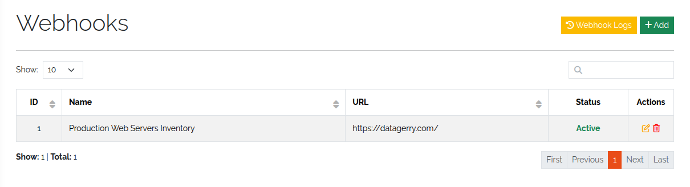
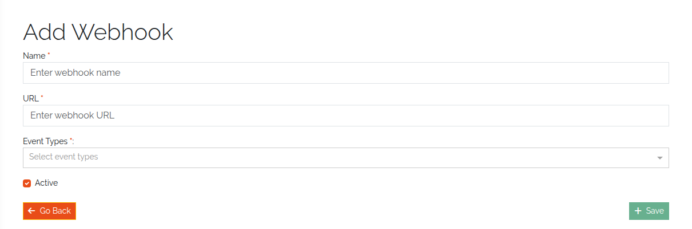

.. _webhooks-anchor:

########
Webhooks
########

.. contents::
   :local:

A webhook sends an HTTP POST request to an external URL whenever an object is created,
updated or deleted. Use it to sync data to other systems, trigger automation pipelines, or
log changes to an external audit system. The request body is described in
:doc:`../reference/webhook-payload`.

.. note::
   Webhooks fire for object events only: **Create**, **Update** and **Delete**.

How webhooks work
=================

* An object event triggers every **active** webhook whose event types include the event.
* DataGerry sends the payload as JSON in a POST request: on create the new object, on
  update the object before and after plus the changes, on delete the object as it was
  before deletion.
* Delivery runs in the background and never blocks or breaks the object operation.
* Any ``2xx`` response counts as delivered. Redirects are not followed, so a ``3xx`` is
  not delivered. The request times out after 3 seconds.
* Every attempt, successful or not, is recorded in the webhook log. A request that got no
  response at all is logged with response code ``0``.
* Only ``http`` and ``https`` URLs on public addresses are accepted. A URL whose host
  resolves to a loopback, private, link-local or other non-public address is refused when
  you save the webhook and again before every delivery.

Ownership
---------

*(3.3)* Every webhook has an **owner**: the user who last saved it. Because the payload
leaves DataGerry — and with it the type's access control — a webhook only receives events
for objects whose type its owner may **read**:

* An event about an object of a type the owner can't read is skipped and not logged.
* A webhook whose owner no longer exists, is deactivated, or was never recorded (webhooks
  from before 3.3) receives nothing until someone saves it again.
* Saving a webhook makes you its owner. When you edit someone else's webhook, or one
  without an owner, the form warns you about this before you save.

The **Owner** column of the webhook list shows the owner and flags webhooks that receive
nothing (no owner, or an inactive owner).

Manage webhooks
===============

Go to **Toolbox → Webhooks**. The list shows ID, name, URL, owner and status.

* **Add** creates a webhook.
* The pencil and trash icons edit and delete a webhook.
* **Webhook Logs** opens the delivery log.

   The webhook list.

Access is controlled by ``base.framework.webhook.view``, ``add``, ``edit`` and ``delete``
*(enforced on routes, menu and save action in 3.3)*. See :doc:`../reference/rights`.

Create a webhook
----------------

.. list-table::
   :header-rows: 1
   :widths: 25 75

   * - Field
     - Meaning
   * - **Name**
     - A descriptive name, for example *Sync to external CMDB*.
   * - **URL**
     - The endpoint that receives the POST request, for example
       ``https://inventory.example.com/api/object-created``.
   * - **Event Types**
     - One or more of **Create**, **Update**, **Delete**.
   * - **Active**
     - Only active webhooks are evaluated.

Click **Save**.

   Creating a webhook.

Check deliveries
----------------

**Webhook Logs** lists every delivery attempt with webhook ID, date, status and response
code. Delete entries you no longer need with the trash icon. Changes to objects the
webhook owner may not read do not appear here.

Examples
========

Notify an inventory system about new objects
   Event type **Create**, URL ``https://inventory.example.com/api/object-created``. When a
   server or workstation is created, the inventory system receives its data.

Log deletions to an audit system
   Event type **Delete**, URL ``https://audit.example.com/webhooks/object-deleted``. The
   audit system receives each deleted object as it was before deletion.
