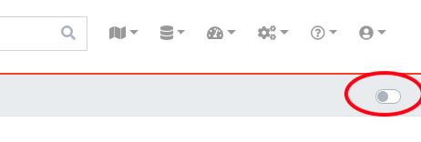
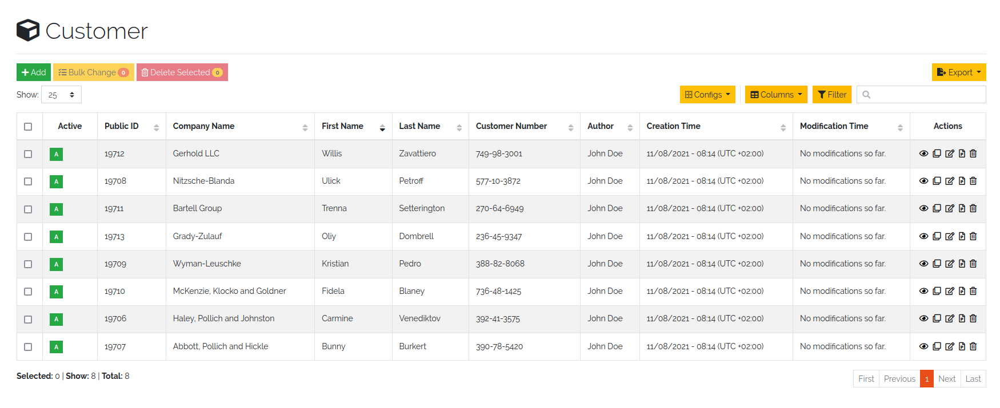
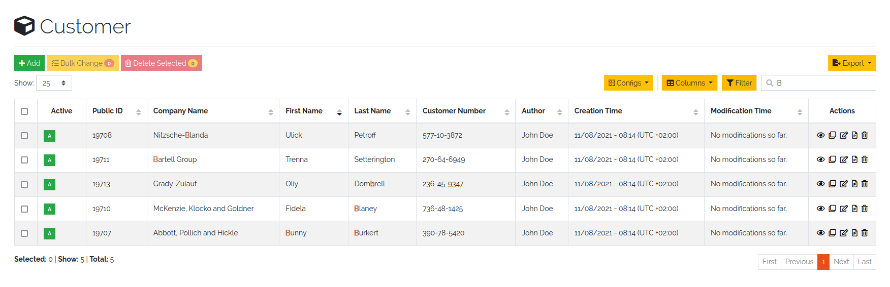
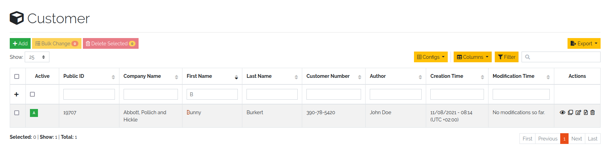
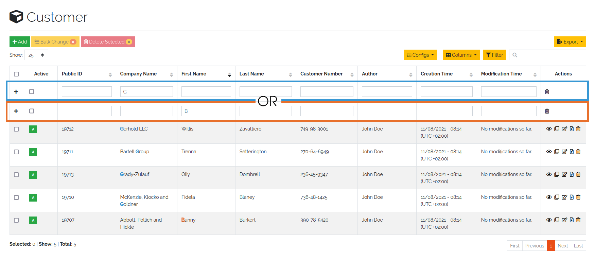
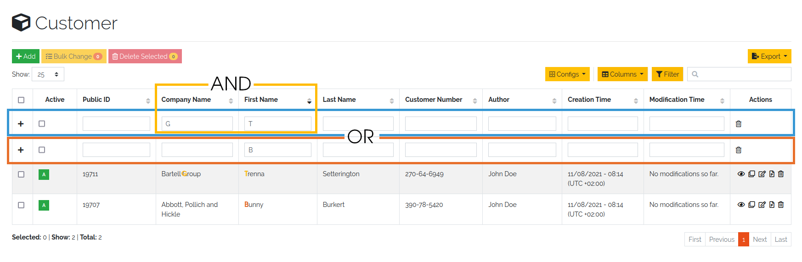

.. _objects-anchor:

#################
Work with objects
#################

.. contents::
   :local:

This page covers the daily work with objects: finding them, choosing what the list shows, searching
and filtering, deactivating, and changing many objects at once. It assumes the types exist
(:doc:`model-types`).

Find objects
============

* **Sidebar** — under **Categories**, open a category and click a type. You get the list of all
  objects of that type.
* **Search bar** — at the top of every page; searches across all types.
* **Framework → Objects** — the list of all objects, regardless of type.

The object list of a type shows the type's summary fields by default. Above it are **Add** (new
object), **Bulk Change**, **Delete Selected** and **Export**. **Add**, **Bulk Change** and **Delete
Selected** only appear when the type is active and you have the rights for them.

Choose the columns
------------------

**Columns** opens a list of all fields of the type. Tick the ones you want to see. **Reset**
returns to the default, the summary fields.

Active and inactive objects
===========================

New objects are active. To deactivate an object, open it and use the switch in its header (you need
the right to edit objects). An inactive object keeps all its data but is hidden in the web
interface.

To see inactive objects, clear the switch **Only active objects** at the right end of the
breadcrumb bar, below the top navigation.

   The switch that shows or hides inactive objects.

Search and filter the list
==========================

The object list has two tools. Both are run by the server against the database, so they find
objects on every page of the list, not only the visible one.

   An unfiltered object list.

Search
------

Type into the search box above the table. DataGerry looks for the term in all searchable columns;
an object matches if any of its columns contains the term. The search is not case-sensitive, and
the term is read as a regular expression, so ``^sw-`` finds values that start with ``sw-``.

   Result of a search for "B".

Filter
------

**Filter** adds an input row under the column headers, so you can search per column.

   Result of filtering one column for "B".

Filters combine like this:

* Terms in the **same row** must all match — they are joined with **AND**.
* Click **+** at the start of the filter row to add another row. **Rows** are alternatives — they
  are joined with **OR**. The trash icon in the **Actions** column removes a row.

   Two filter rows: objects matching either row (OR).

   Two terms in one row: objects matching both (AND).

Dates are searched as text in the form ``YYYY-MM-DDThh:mm``, for example ``2019-12-19T11:02``. A
prefix such as ``2019-12`` finds everything from that month.

An export from the list (**Export**) contains the visible columns and only the objects the current
search or filter leaves — or only the selected objects, if you selected any.

Change many objects at once
===========================

A **bulk change** writes the same values into several objects of one type.

#. In the object list, select the objects and click **Bulk Change**.

   .. figure:: ../img/objects/objects_bulk_change_list.png
      :width: 700

      Objects selected for a bulk change.

#. **Bulk Changes** — the form looks like the form for a new object. Fill in only the fields you
   want to change. At the top you can also set all objects **Active** or **Inactive**; **N/A**
   leaves the state as it is.

   .. figure:: ../img/objects/objects_bulk_change_active.png
      :width: 700

      The change template.

#. **Preview** — lists every change per object. Go back to adjust if needed.

   .. figure:: ../img/objects/objects_bulk_change_preview.png
      :width: 700

      Preview of the changes.

#. **Complete** — DataGerry applies the changes and lists the changed objects, and any that
   failed.

   .. figure:: ../img/objects/objects_bulk_changed.png
      :width: 700

      Result of a bulk change.

Multi data sections are not part of a bulk change; edit them per object.
