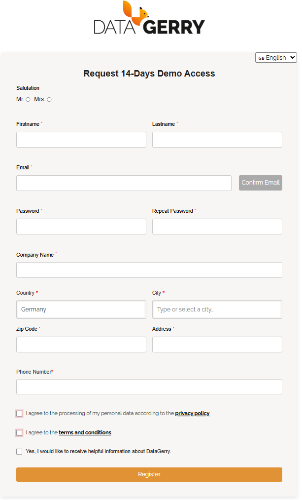
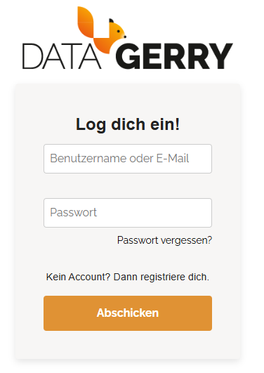

###################
Start in the cloud
###################

.. contents::
   :local:

|cloud| The fastest way to try DataGerry: a 14-day trial with all features, no installation. To
run DataGerry on your own server instead, see :doc:`self-hosted-quickstart`.

Sign up for a trial
===================

1. Open `service.datagerry.com/demo <https://service.datagerry.com/demo>`_.
2. Fill in the registration form and confirm.
3. Open the e-mail you receive and confirm your address with the link in it. You cannot sign in
   before the address is confirmed.

   The trial sign-up form.

The trial is a full subscription with every feature switched on. When it ends, you can turn it
into a paid subscription in the Service Portal; see :doc:`../cloud/subscriptions`.

Two places to sign in
=====================

As a cloud customer you work with two applications, both with the same e-mail address and
password:

.. list-table::
   :header-rows: 1
   :widths: 30 30 40

   * - Application
     - Address
     - What you do there
   * - **Service Portal**
     - `service.datagerry.com <https://service.datagerry.com/login>`_
     - Subscriptions, users, invoices, API keys, support tickets.
   * - **DataGerry**
     - `cloud.datagerry.com <https://cloud.datagerry.com>`_
     - The CMDB itself — everything else in this documentation.

The Service Portal's sidebar has a **Cloud Access** link that takes you to DataGerry.

   Service Portal sign-in.

Sign in to DataGerry
====================

1. Open `cloud.datagerry.com <https://cloud.datagerry.com>`_.
2. Enter your **e-mail address** and password — not a user name.
3. If your account belongs to more than one subscription, DataGerry asks you to **Select a
   subscription**. Each subscription is a separate CMDB with its own data; pick the one you want
   to work in and click **Proceed**.

Forgot your password? The **Forgot Password?** link on the sign-in page resets it in the Service
Portal — the password is the same for both applications.

First steps
===========

* On your first sign-in, the **Start Assistant** (*Welcome to DATAGERRY*) offers to create a
  ready-made set of types for your industry. Cancel it to start from scratch; while the data
  model is still empty you can reopen it from **Toolbox → Assistant**. See
  :doc:`../guides/assistant`.
* Or build your first type yourself: :doc:`first-cmdb`.
* Invite colleagues in the Service Portal: :doc:`../cloud/users`.
* The bar at the top shows how many objects your subscription holds and its limit
  (*Objects 120 / 10000*).
