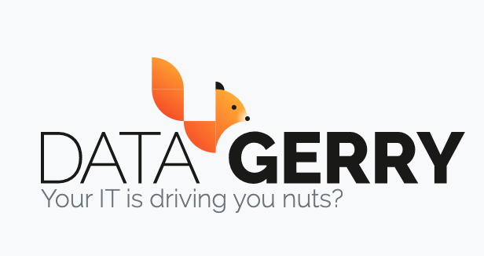

############
Introduction
############

.. contents::
   :local:

What DataGerry is
=================

DataGerry is a configuration management database (CMDB) and asset management tool. Instead of
shipping a fixed schema for "servers" or "switches", it lets you define the kinds of things you
want to track — and which fields they have — and then holds the records, their relationships and
their history.

A typical use: you define a *Server* type with a host name, an IP address, an operating system
and a reference to the *Rack* it is mounted in. Your team records each server as an object; the
rack view shows which height units are occupied, the CI Explorer draws what depends on what, a
report lists every server whose warranty runs out this year, and a webhook tells your monitoring
system whenever a server is added.

The pieces
==========

.. list-table::
   :header-rows: 1
   :widths: 24 76

   * - Piece
     - What it is
   * - **Type**
     - The blueprint for a kind of thing — *Server*, *Router*, *Contract*. Defines sections and
       fields. See :doc:`../concepts/data-model`.
   * - **Object**
     - One record of a type — the server ``web-01``. Also called a CI (configuration item).
   * - **Category**
     - A folder for types in the sidebar.
   * - **Section template**
     - A reusable group of fields — for example an *Interfaces* or *Ports* section — that many
       types can share.
   * - **Relation**
     - A typed many-to-many link between objects, such as *runs on* or *is backed up by*. See
       :doc:`../concepts/relationships`.
   * - **Location**
     - The place in a tree of sites, buildings and rooms where an object is.
   * - **User, group, right**
     - Who may sign in and what they may see and change. See :doc:`../concepts/permissions`.

Beyond the core CMDB, DataGerry includes IP address management with racks and cabling, an
information security management system (ISMS), a document generator, reports, webhooks,
automations, imports and exports, and a REST API.

Cloud or self-hosted
====================

You can use DataGerry as a cloud service run by becon or install it on your own server. The
application is the same; sign-in, licensing and who operates the servers are not.
:doc:`editions` explains the differences and helps you choose.

What is new in 3.3
==================

3.3 brings the physical layer into the CMDB: a **rack view** to mount objects into racks,
**ports and patch panels** on any object, **cables** connecting them and a **cabling view** that
draws the connections. Imports and exports now cover multi data sections, and every area of the
interface is consistently controlled by rights. See :doc:`whats-new-3-3`.

Where to go next
================

* :doc:`editions` — decide between cloud and self-hosted.
* :doc:`cloud-quickstart` or :doc:`self-hosted-quickstart` — get an instance.
* :doc:`first-cmdb` — model your first type and record objects, end to end.
